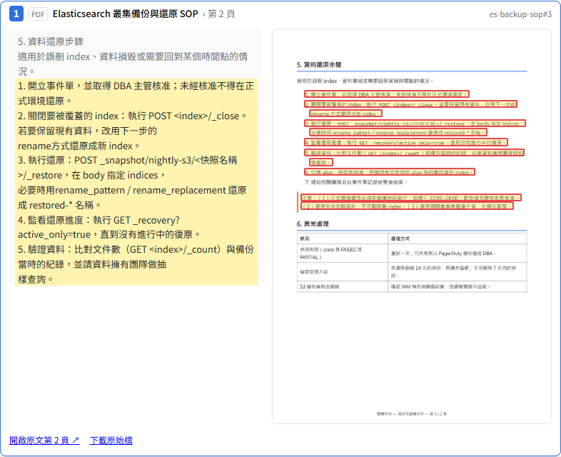

<div align="center">

# Agentic RAG on Elasticsearch

**English** | [繁體中文](README.zh-TW.md)

**A full-stack RAG system built end to end: ingestion, four retrieval modes behind a
read-only MCP server, a decision layer, a CRAG-style retrieval loop, a Pi agent that
cites its sources, and an evaluation suite that keeps a held-out test set.**

Everything runs locally: Elasticsearch in Docker, `qwen3.5:4b` and `bge-m3` on an 8 GB GPU through Ollama.


</div>

---

## Contents

- [What it does](#what-it-does)
- [Architecture](#architecture)
- [PDF, PowerPoint and evidence screenshots](#pdf-powerpoint-and-evidence-screenshots)
- [Evaluation](#evaluation)
- [Design decisions](#design-decisions)
- [Security model](#security-model)
- [Quick start](#quick-start)
- [Configuration](#configuration)
- [Project layout](#project-layout)
- [Limitations](#limitations)

## What it does

Ask questions about a document collection: Markdown, **PDF, PowerPoint and Word**. The bundled corpus is the
Traditional Chinese documentation of my other public projects plus generated test SOPs and slides. Every answer is grounded in retrieved passages,
cites them, and says "沒有相關資料" (no relevant data) instead of guessing.

- **Four retrieval modes** over the same index: `keyword` (BM25), `vector` (kNN),
  `hybrid` (weighted RRF computed in TypeScript) and `cascade` (strict keyword first, vectors fill the gap).
- **Decision layer** in front of the agent: rules → domain similarity → an LLM typed decision.
  Out-of-scope questions and prompt injection never reach the agent.
- **CRAG loop run by code, not by the model**: retrieve → grade "is this enough?" →
  retry with a rewritten query and an untried mode → generate, or fail closed.
- **Pi agent** (`@mariozechner/pi-agent-core`) with exactly two read-only tools over MCP and a hard tool budget.
- **Citation check**: every cited passage id must have been retrieved in this turn; fabricated ones are removed and flagged.
- **Evidence you can see**: every cited PDF / PPT passage comes with a screenshot of its page, the matching lines boxed,
  plus the quoted text and a link that opens the original at that page.
- **SOP answers**: "how do I…" questions get summary → prerequisites → every step in the original order (each cited) → warnings;
  neighbouring chunks are pulled in so steps split across pages are not lost.
- **Document-level ACL** enforced inside the MCP server's Elasticsearch query, never by the LLM.
- **Chat UI** with streaming, numbered citations, source cards, a trace panel (decision,
  every retrieval round, grader verdicts, tool calls), history, settings, 👍/👎 and document upload.
- **SQLite** stores users, settings, conversations, every message with its full trace, feedback and an MCP audit log.

## Architecture

```
Browser (React, AI SDK useChat)
   │  UI message stream (SSE)
   ▼
Backend (Fastify)                                     SQLite
 ① Decision layer  rules → domain similarity → LLM ── users / settings / conversations
 ② CRAG loop       retrieve → grade → retry (≤ 2)      messages + full trace / feedback
 ③ Pi agent        tools: search, get_document          tool_audit
 ④ Citation check  cited ids ⊂ retrieved ids
   │  MCP (stdio locally, Streamable HTTP + bearer token in Docker)
   │  user groups travel in request _meta, not in tool arguments
   ▼
MCP retrieval server (read-only)                     Ollama (host GPU)
 search(mode, query, k, rerank) / get_document ───▶ bge-m3 embeddings
 ACL filter in every ES query, audit log,            qwen3.5:4b (16k ctx variant)
 optional cross-encoder rerank (CPU)
   │  read-only API key scoped to one index
   ▼
Elasticsearch 9.5 (Basic)
 content: ICU tokenizer + Traditional→Simplified filter (BM25)
 embedding: dense_vector 1024, cosine (kNN)
 metadata: title, heading path, source, acl
   ▲
Ingestion: Markdown → heading-aware chunks → "doc > section" prefix → embed → upsert
           PDF / PPTX / DOCX → (LibreOffice → PDF) → per-page lines with positions + page JPEGs → chunks
```

## PDF, PowerPoint and evidence screenshots



**Ingestion.** PPTX and DOCX are converted to PDF with LibreOffice (headless), so every format follows one path:
`pdfjs-dist` extracts each page's text **line by line with its position on the page**, and every page is rendered
to a JPEG. A slide is one chunk titled `投影片 N｜<slide title>`; PDF pages are chunked by size, with larger-font short
lines detected as section headings (`5. 資料還原步驟（第 2 頁）`). Line positions are stored in the chunk
(`layout`, not indexed) and returned by the MCP server only when the backend asks for them in `_meta`.

**Evidence in the answer.** For each cited passage the UI shows an evidence card: document, page or slide, the quoted
lines with the ones the answer actually used highlighted (character-bigram overlap with the sentences citing that
passage), and the page screenshot with those lines boxed. Screenshots and originals are served only after the backend
asks the MCP server whether this user can read the document — no access, no screenshot.

**SOP answers.** The decision layer also classifies `answer_type`. For `procedure` questions the pipeline fetches the
neighbouring chunks of the top passages (steps often continue on the next page) and the prompt requires:
summary → prerequisites → all steps in the original order and numbering, each cited → warnings, and an explicit note
if the steps look incomplete.

**Real-world PDF problems this had to handle** (found by reading what was extracted, not by tuning):

| Problem | Fix |
|---|---|
| Chrome-printed PDFs extract some characters as Kangxi radicals: 「執⾏」 is U+2F8F, not 行, so a search for 執行 misses | Map U+2F00–2FDF with NFKC, plus a table for the CJK Radicals Supplement (⻑ → 長) |
| Auto-wrapped lines split words (抽 / 樣), breaking BM25 | Re-join lines: CJK joins directly, Latin gets a space, keep the newline after full-width sentence punctuation, list markers or a font-size jump |
| Page headers and footers repeat on every page | Lines in the top / bottom 12% that repeat on most pages are dropped |
| Chinese file names produced non-ASCII chunk ids the citation check could not see | ids are always `[a-z0-9-]`; non-ASCII names get a short hash |

<!-- FILE_RESULTS -->

## Evaluation

The golden set ([`eval/golden.json`](eval/golden.json)) has **48 questions** written by hand
from the corpus, split into a **tune** set (used while developing) and a **test** set (never
used to tune anything), plus **14 trap questions**: out-of-scope, direct prompt injection,
injection hidden inside a document, ACL leaks, unanswerable-but-in-domain, and chit-chat.

Gold labels are **evidence sentences**, not chunk ids: a passage counts as relevant if it
contains the sentence. Changing the chunker therefore doesn't silently break the labels.

### Retrieval (test set, 24 questions)

Every mode can be combined with `rerank=true` on the MCP `search` tool: the first stage fetches
20 candidates, a cross-encoder (`bge-reranker-base`, ONNX on CPU) re-scores them, the top k come back.

| Mode | Hit@1 | Hit@3 | Hit@5 | MRR@10 | + rerank: Hit@1 | Hit@5 | MRR@10 |
|---|---|---|---|---|---|---|---|
| keyword (BM25) | 63% | 79% | 88% | 0.732 | 83% | **100%** | **0.910** |
| vector (kNN) | 67% | 83% | 88% | 0.764 | **88%** | 96% | 0.906 |
| hybrid (weighted RRF) | 67% | 83% | 92% | 0.775 | 83% | **100%** | 0.906 |
| cascade | 58% | 83% | 83% | 0.699 | **88%** | 96% | 0.906 |

<sub>First stage alone: 17–58 ms per query. Rerank adds about 0.9 s (20 candidates, CPU). RTX 3060 Ti 8 GB.
On the tune set keyword search alone was much weaker (63% Hit@5); with rerank every mode lands around MRR 0.9 on both splits.</sub>

#### Choosing the reranker

`scripts/eval-rerank.ts` compares models and candidate counts. The smaller model won on **both** splits,
so the choice made on the tune set held up on the test set:

| Test set, hybrid candidates | MRR@10 | Hit@5 | Rerank time / question |
|---|---|---|---|
| no rerank | 0.773 | 92% | — |
| `bge-reranker-v2-m3` (568M, int8), 20 candidates | 0.861 | 96% | 3.4 s |
| `bge-reranker-base` (278M, int8), 10 candidates | 0.885 | 96% | 0.7 s |
| **`bge-reranker-base` (278M, int8), 20 candidates** | **0.906** | **100%** | 1.6 s |

<sub>A guess, not verified: the int8 quantisation hurts v2-m3 more; its fp32 weights (2.2 GB) are too slow on CPU to test here.
The rerank score is also a usable relevance signal: at a 0.5 cut-off it kept 96% of gold passages and dropped 53–68% of the rest,
about the same as the LLM grader (91–93% kept, 65–75% dropped).</sub>

### End to end (test set)

Generated by `rag-qwen3.5-4b`, graded by `qwen3.5:9b` (a larger model than the generator),
then spot-checked by hand. Traps are scored by rules (forbidden strings, refusal), not by an LLM.

| Metric (test set: 24 questions + 7 traps) | Decision layer (default) | No decision layer | + rerank v2-m3 (old) | **+ rerank base, in MCP** |
|---|---|---|---|---|
| In-scope questions wrongly blocked | 0% | — | 0% | 0% |
| Gold passage reached the context | 88% | 92% | 92% | 92% |
| Answer correct (judge) | 83% | 79% | 79% | **88%** |
| Key-point coverage (judge) | 81% | 79% | 83% | **88%** |
| Contains unsupported claims (judge, lower is better) | **13%** | 21% | 21% | **13%** |
| Citation check passed (code) | 79% | 83% | **96%** | 88% |
| Traps passed, rule scorer | 6/7 | 6/7 | 5/7 | 6/7 |
| Traps passed, after manual review | 6/7 | 7/7 | 6/7 | 7/7 |
| Avg latency (traps) | 7.0 s (4.7 s) | 4.9 s (7.5 s) | 8.8 s (6.8 s) | not comparable* |

<sub>Raw answers, traces and judge notes: `results/e2e-test-*.json` (not committed; reproduce with the commands in Quick start).
The rule scorer misses correct refusals worded differently ("知識庫中無法執行您的請求", "沒有資料顯示…"); manual review counts them as passes.
"嗨，你好！" failed in the first two decision-layer runs (blocked as out of scope); the greeting rule added afterwards fixed it in the last run.
\* The last run overlapped with games using the same GPU: every stage slowed down, including ones rerank doesn't touch
(decision 2.3 → 6.7 s, generation 2.3 → 5.2 s), so its 19 s average says nothing about rerank. Quality metrics are unaffected (temperature 0).</sub>

### What the numbers changed

With 24 test questions, one question is about 4 points, so read the differences as direction, not proof.

- **The first reranker improved retrieval but not answers; the second one improved both.** With `bge-reranker-v2-m3` correctness stayed at 79%. Swapping in the smaller `bge-reranker-base` (better on both splits), moving rerank into the MCP server and querying only the rewritten question raised correctness to 88% and coverage to 88%. Rerank stays opt-in because it costs about a second per retrieval round on CPU.
- **The decision layer is mostly a safety and cost feature.** Out-of-scope and injection traps stop before the agent (4.7 s vs 7.5 s), and answers had fewer unsupported claims (13% vs 21%). It costs about 2 s per question, and its query rewriting slightly lowered how often the gold passage reached the context (88% vs 92%).
- **Without rerank, the differences between modes are inside the noise.** Two test-set runs of the same first-stage code differed by up to 0.04 MRR (hybrid 0.733 → 0.775, keyword 0.750 → 0.732), probably from index segment merges after re-ingestion shifting BM25 statistics and small embedding differences. That is as large as the gaps between keyword, vector and hybrid, so the BM25 weight of 0.3 tuned on the tune set is not proven either way. With rerank the modes converge (MRR ≈ 0.91), which is a stronger result than any single mode choice.
- **The CRAG grader can throw away the right passage.** In q34 the gold passage was retrieved in round 1, the grader marked it irrelevant, and the answer said "no data". Next step: always keep the top passages, or grade with a larger model.
- **The biggest fixes came from looking at traces, not from tuning:** Traditional Chinese tokenisation (ICU instead of smartcn), the decision layer wrongly rejecting a real question until it was shown the nearest passages, and the model picking `keyword` mode whenever a project name appeared.

## Design decisions

| Decision | Why |
|---|---|
| **ICU tokenizer + Traditional→Simplified filter**, not `smartcn` | `standard` splits Chinese into single characters. `smartcn` only knows Simplified Chinese — tested: Traditional text still falls back to one token per character. ICU segments both scripts; the transform filter makes 资料 and 資料 the same token. |
| **RRF in TypeScript**, not the ES `rrf` retriever | The `rrf` retriever needs a Platinum license; on Basic it returns 403 (verified). Computing it in code also makes the fusion visible and tunable: BM25 weight 0.3 beat 1.0 on the tune set. |
| **Pi SDK embedded**, not ACP or Goose | ACP drives an external coding agent that brings its own file and shell tools; Goose ships a shell extension. A Q&A agent is safest when it simply has no dangerous capability: two read-only tools, nothing else. |
| **Program-controlled CRAG loop** | A 4B model is unreliable at deciding the flow. The model only does narrow JSON tasks (classify, rewrite, grade); code decides what happens next and never repeats a query/mode pair. |
| **Decision layer sees the nearest passages** | Without that hint the model rejected "how much electricity does japan-trip-bot use?" as general knowledge (confidence 0.95). If similarity is high, the retrieval evidence overrides an "out of scope" verdict (never an "injection" one). |
| **Thresholds from the tune set** | In-domain questions scored ≥ 0.61 cosine against the corpus, out-of-scope ones ≤ 0.50, so the cut-off is 0.55. |
| **Heading-path prefix before embedding** | A cheap version of contextual retrieval: "doc > section > subsection" is prepended to each chunk, no extra LLM call. |
| **SQLite, not Redis** | One app on one machine. Redis would only pay off for multiple app instances sharing sessions. |
| **Rerank inside the MCP server, smaller model** | Any MCP client gets it as `rerank=true` on any mode. `bge-reranker-base` beat `bge-reranker-v2-m3` (int8) on both splits at a third of the time. With rerank on, only the rewritten question is searched: 20 candidates already reach 100% Hit@5, and reranking every variant would multiply CPU time. Still opt-in (≈1 s per round). |

## Security model

Each layer assumes the one above it has failed.

| Layer | Mechanism | Stops |
|---|---|---|
| Capability | The agent has only `search` and `get_document`, both `readOnlyHint` | writing files, running commands, browsing |
| Data | MCP server uses an API key with `read` on one index only (write, delete and other indices return 403 — verified) | anything the MCP server is tricked into |
| Access control | `acl` on every chunk; the MCP server adds the filter from `_meta.groups`, which the LLM cannot see or set. Unauthorised and missing documents look identical | reading other teams' documents |
| Input | Decision layer: rules, domain similarity, typed decision | off-topic use, direct injection |
| Content | Retrieved text is wrapped as data and the prompt says it is not instructions; [a trap document](corpus/zz-injection-test.md) tests this | indirect prompt injection |
| Output | Citation check | invented sources |
| Process | Docker: read-only filesystem, non-root, `cap_drop: ALL`, `no-new-privileges`; HTTP MCP requires a bearer token; the rerank model is baked into the image so the MCP container needs no internet access at runtime | blast radius |
| Audit | Every MCP call (who, query, returned ids) is stored in SQLite | after-the-fact review |
| Upload | Admin only; the ACL can only name groups the uploader belongs to; frontmatter `acl` in uploaded files is ignored | privilege escalation through upload |

## Quick start

Requirements: Node.js 22+, Docker, [Ollama](https://ollama.com) with a GPU (8 GB is enough), and LibreOffice
for PowerPoint / Word files (`soffice` on PATH, or inside WSL on Windows; the Docker image includes it).

```bash
git clone https://github.com/KJLavender/agentic-rag-es.git
cd agentic-rag-es
npm install
cp .env.example .env              # set ELASTIC_PASSWORD and MCP_TOKEN

ollama pull qwen3.5:4b && ollama pull bge-m3
npm run setup:model               # 16k-context variant (Ollama's OpenAI API ignores num_ctx)

docker compose up -d              # Elasticsearch with the ICU plugin
npm run es:setup                  # create the index and two least-privilege API keys → .env.local
npm run ingest                    # corpus/ + corpus/files/ (PDF, PPTX) → chunks → embeddings → Elasticsearch

npm run build:web && npm start    # http://127.0.0.1:8787
```

Other entry points:

```bash
npm run ask -- "AIOps v2 為什麼要把 agent 拆開？"            # whole pipeline in the terminal
npm run ask -- --groups team --rerank "Report Server 上傳 422 怎麼辦？"
npm run mcp                                                  # MCP server on stdio (e.g. for MCP Inspector)
npm run eval:retrieval -- --split test --rerank
npx tsx scripts/eval-rerank.ts --split test                 # reranker models × candidate counts
npm run eval:e2e -- --split test [--no-decision] [--rerank] [--mode hybrid]
npm test
```

Everything in Docker (Ollama stays on the host):

```bash
docker compose --env-file .env --env-file .env.local --profile app up -d --build
```

The UI has a user switcher (`guest` = public, `member` = public + team, `admin` = can also
upload) to demonstrate the ACL. It is **not** authentication — see [Limitations](#limitations).

## Configuration

| Variable | Default | Meaning |
|---|---|---|
| `ES_URL` | `http://127.0.0.1:9200` | Elasticsearch |
| `ES_INGEST_API_KEY` / `ES_SEARCH_API_KEY` | from `npm run es:setup` | write key (ingestion, upload) / read-only key (MCP server) |
| `OLLAMA_URL` | `http://127.0.0.1:11434` | Ollama |
| `LLM_BASE_MODEL` / `LLM_MODEL` | `qwen3.5:4b` / `rag-qwen3.5-4b` | base model / 16k-context variant used for everything |
| `EMBED_MODEL` / `EMBED_DIMS` | `bge-m3` / `1024` | must match the index mapping; changing it needs `es:setup -- --recreate` |
| `CHUNK_MAX_CHARS` / `CHUNK_OVERLAP` | `600` / `80` | chunking |
| `HYBRID_KEYWORD_WEIGHT` | `0.3` | BM25 weight in hybrid RRF (vectors are 1) |
| `RERANK_MODEL` / `RERANK_CANDIDATES` | `Xenova/bge-reranker-base` / `20` | cross-encoder and how many first-stage candidates it re-scores |
| `DOMAIN_MIN_SIMILARITY` / `DOMAIN_STRONG_SIMILARITY` | `0.55` / `0.65` | below: out of scope; above: overrides an LLM "out of scope" |
| `DECISION_MIN_CONFIDENCE` | `0.5` | below: ask the user to clarify |
| `MAX_RETRIEVAL_ROUNDS` | `2` | extra CRAG rounds |
| `CONTEXT_K` | `6` | passages per round |
| `DOCS_DIR` | `data/docs` | originals, converted PDFs and page screenshots |
| `MCP_URL` / `MCP_TOKEN` | unset | use Streamable HTTP instead of a stdio child process |

## Project layout

```
src/
  ingest/        chunker (heading-aware, junk filter, contextual prefix) and upsert
  retrieval/     four modes, RRF, optional cross-encoder rerank
  mcp/           MCP retrieval server (stdio / Streamable HTTP)
  agent/         decision layer, grader, CRAG pipeline, Pi generation, citation check
  db/            SQLite schema
  server/        Fastify API + AI SDK UI message stream
  shared/        message types shared with the UI
web/             React UI
scripts/         es:setup, ingest, ask, evaluations, threshold calibration, UI smoke test
eval/golden.json questions, evidence sentences, traps
corpus/          bundled documents (with a prompt-injection trap)
docs/plan.md     original plan (Traditional Chinese)
```

## Limitations

- **No real authentication.** The user switcher is a cookie for demonstrating ACLs. Put it behind SSO / a reverse proxy before sharing it.
- **4B model.** It occasionally mixes in Simplified characters (converted with OpenCC), over-reads passages or misses a point; the trace panel and citation check make that visible, they don't prevent it.
- **Small evaluation.** 24 test questions on one corpus is a method demonstration, not a benchmark. The LLM judge is itself a model; its notes are in `results/` for review.
- **One GPU, one question at a time.** Requests queue.
- **No OCR yet.** Text inside images (screenshots pasted into a PDF, scanned pages) is not searchable; the page screenshot still shows it.
- **PDF tables** come out row by row and cells that wrap across lines can interleave; answers about tables are less reliable than prose.
- **Elasticsearch over plain HTTP** on localhost. Enable TLS before exposing it.
- **Rerank runs on CPU** and adds about a second per retrieval round. Locally the first use downloads the model (~280 MB); the Docker image ships with it.

## License

MIT
