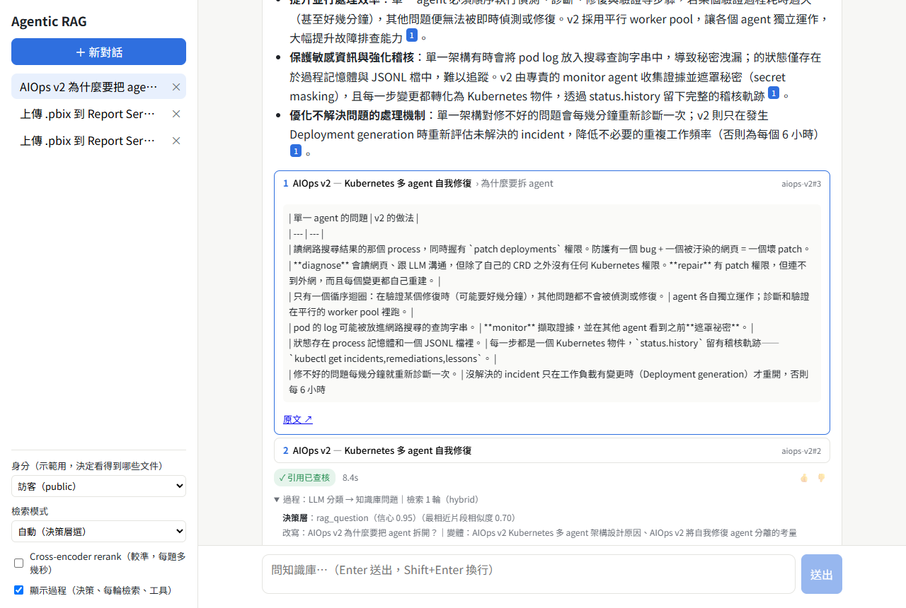
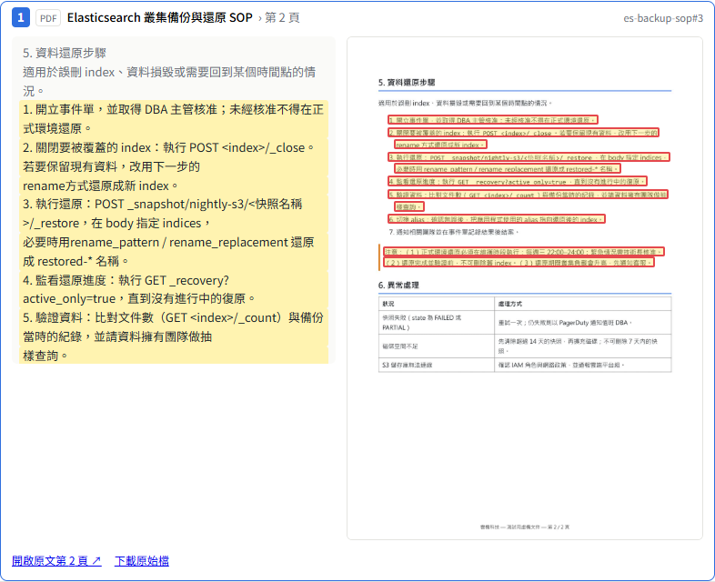

# Agentic RAG on Elasticsearch

**English** | [繁體中文](README.zh-TW.md)

You ask a question in a chat box. The system finds the matching passages in your documents, has a language model write an answer from them, and shows which passages it used. If the documents don't contain the answer, it says so ("沒有相關資料", "no relevant data") instead of guessing.

This pattern is called RAG (retrieval-augmented generation): search first, then let the model answer only from what the search found. Everything here runs on one machine: Elasticsearch (a search engine) in Docker, and two models served by Ollama on an 8 GB GPU, `qwen3.5:4b` for answers and `bge-m3` for embeddings (numbers that represent the meaning of a text, used to find similar passages).



## What it does

You can ask about Markdown, PDF, PowerPoint and Word files. The bundled corpus is the Traditional Chinese documentation of my other public projects, plus generated test SOPs (step-by-step procedures) and slides.

- Search has four modes over the same index: `keyword` (BM25, classic word matching), `vector` (kNN, nearest meaning), `hybrid` (both, merged with weighted reciprocal rank fusion, "RRF") and `cascade` (strict keyword search first, vectors fill the gap). Any mode can also re-score its top 20 results with a second model (a reranker).
- Before the agent sees a question, a decision step checks it: simple rules, then how close the question is to the corpus, then a typed LLM decision. Off-topic questions and prompt injection (text that tries to give the model new orders) are stopped there.
- The retrieval loop is plain code, not the model's choice. It searches, asks the model "is this enough to answer?", and if not, retries with a rewritten query and a search mode it hasn't tried yet, up to 2 extra rounds. If it still has nothing, it refuses. This pattern is known as CRAG.
- The answering agent is built on Pi (`@mariozechner/pi-agent-core`). It gets two read-only tools, `search` and `get_document`, served through MCP (Model Context Protocol, a standard way for an LLM app to call tools), with a hard limit on tool calls.
- A citation check makes sure every passage id in the answer was really retrieved in this turn. Invented ones are removed and flagged.
- For every cited PDF or PowerPoint passage, the UI shows the page screenshot with the used lines boxed, the quoted text, and a link to the original at that page.
- "How do I..." questions get a fixed shape: summary, prerequisites, every step in the original order (each cited), warnings. Neighbouring chunks are pulled in so steps that continue on the next page are not lost.
- Access control is per document. The MCP server adds the filter to every Elasticsearch query, so the model cannot change it.
- The chat UI streams answers, numbers the citations, and has a trace panel (decision, each retrieval round, grader verdicts, tool calls), history, settings, thumbs up/down and document upload. SQLite stores users, settings, conversations, each message's full trace, feedback and an MCP audit log.

## How it works

```
Browser (React, AI SDK useChat)
   |  UI message stream (SSE)
   v
Backend (Fastify)                                     SQLite
 1 Decision layer  rules -> domain similarity -> LLM  users / settings / conversations
 2 CRAG loop       retrieve -> grade -> retry (<= 2)  messages + full trace / feedback
 3 Pi agent        tools: search, get_document        tool_audit
 4 Citation check  cited ids are a subset of retrieved ids
   |  MCP (stdio locally; Streamable HTTP + bearer token in Docker)
   |  user groups travel in the request _meta, not in tool arguments
   v
MCP retrieval server (read-only)                      Ollama (host GPU)
 search(mode, query, k, rerank) / get_document  --->  bge-m3 embeddings
 ACL filter in every ES query, audit log,             qwen3.5:4b (16k context variant)
 optional cross-encoder rerank (CPU)
   |  read-only API key for one index
   v
Elasticsearch 9.5 (Basic license)
 content:   ICU tokenizer + Traditional-to-Simplified filter (BM25)
 embedding: dense_vector 1024, cosine (kNN)
 metadata:  title, heading path, source, acl

Ingestion: Markdown -> heading-aware chunks -> "doc > section" prefix -> embed -> upsert
           PDF / PPTX / DOCX -> (LibreOffice -> PDF) -> per-page lines with positions + page JPEGs -> chunks
```

## PDF, PowerPoint and evidence screenshots



PPTX and DOCX files are first converted to PDF with LibreOffice (headless), so every format takes one path. `pdfjs-dist` reads each page line by line together with each line's position, and every page is rendered to a JPEG. A slide becomes one chunk titled `投影片 N｜<slide title>`. PDF pages are cut by size, and short lines in a larger font are treated as section headings. Line positions are stored in the chunk (`layout`, not indexed) and returned by the MCP server only when the backend asks for them.

The evidence card marks the lines the answer actually used. It picks them by character-bigram overlap with the sentences that cite the passage. Screenshots and originals are served only after the backend asks the MCP server whether this user may read the document.

For questions classified as `procedure`, the pipeline also fetches the neighbouring chunks of the top passages, and the prompt asks for an explicit note when the steps look incomplete.

These real-PDF problems turned up by reading the extracted text:

| Problem | Fix |
|---|---|
| PDFs printed from Chrome extract some characters as Kangxi radicals: 「執⾏」 contains U+2F8F, not 行, so searching 執行 finds nothing | Map U+2F00-2FDF with NFKC, plus a table for the CJK Radicals Supplement (⻑ to 長) |
| Automatic line wrapping splits words (抽 / 樣), which breaks BM25 | Re-join lines: CJK joins directly, Latin gets a space; keep the line break after full-width sentence punctuation, list markers or a font-size jump |
| Page headers and footers repeat on every page | Drop lines in the top and bottom 12% that repeat on most pages |
| Chinese file names gave chunk ids with non-ASCII characters that the citation check could not see | Ids are always `[a-z0-9-]`; non-ASCII names get a short hash |

Results on `eval/golden-files.json`: 13 questions on generated SOP PDFs and slides (4 are SOPs, plus 3 trap questions), and 6 questions on three real PDFs from my older repos. The real PDFs stay local because they contain personal data.

| Metric | Generated PDF / PPTX | Real PDFs (local only) |
|---|---|---|
| Gold passage reached the context | 100% | 83% |
| Answer correct (judge) | 92% | 83% |
| Key-point coverage (judge) | 85% | 72% |
| Unsupported claims (judge) | 8% | 17% |
| Citation check passed | 100% | 83% |
| SOP answers listing every step | 3/4 | 1/2 |
| Evidence screenshot available for cited PDF / PPT passages | 13/13 | 6/6 |
| Traps (ACL leak, unanswerable) | 2/3 | not applicable |

Reading the answers by hand found two problems, both fixed after this run. "Which number do I call?" was treated as a procedure and padded with unrelated steps. "How do I back up Kafka?" borrowed the Elasticsearch steps instead of saying there is no such procedure. The decision step now treats single-fact questions as facts, and the SOP prompt must answer "no relevant data" when the passages lack that system's procedure. On the real PDFs the misses are a table question (the schema lives in SQL dumps that chunk poorly) and an SOP whose steps sit in two report sections.

## Evaluation

The golden set ([`eval/golden.json`](eval/golden.json)) has 48 hand-written questions based on the corpus. They are split into a tune set (looked at while developing) and a test set (never used to tune anything). It also has 14 trap questions: out of scope, direct prompt injection, injection hidden inside a document, ACL leaks, in-domain but unanswerable, and chit-chat.

Gold labels are evidence sentences, not chunk ids. A passage counts as relevant if it contains the sentence, so changing the chunker does not silently break the labels.

### Retrieval (test set, 24 questions)

Hit@k is the share of questions whose gold passage is in the top k. MRR@10 is the average of 1 divided by the rank of the first gold passage (higher is better, 1.0 is perfect). With `rerank=true`, the first stage fetches 20 candidates, a cross-encoder (`bge-reranker-base`, ONNX, on CPU) re-scores them, and the top k come back.

| Mode | Hit@1 | Hit@3 | Hit@5 | MRR@10 | With rerank: Hit@1 | Hit@5 | MRR@10 |
|---|---|---|---|---|---|---|---|
| keyword (BM25) | 67% | 75% | 83% | 0.736 | 83% | 100% | 0.906 |
| vector (kNN) | 67% | 83% | 88% | 0.764 | 83% | 92% | 0.873 |
| hybrid (weighted RRF) | 58% | 83% | 92% | 0.729 | 88% | 96% | 0.922 |
| cascade | 58% | 83% | 83% | 0.699 | 83% | 92% | 0.868 |

The first stage takes 17-58 ms per query. Rerank adds about 0.9 s (20 candidates, CPU). Measured on an RTX 3060 Ti with 8 GB. On the tune set, keyword search alone was much weaker (63% Hit@5); with rerank every mode ends up around MRR 0.9 on both splits.

These retrieval numbers were re-measured on 2026-10-21, after the PowerBI MCP documents in the corpus were updated and three were added. The question that dropped is q44 ("which time windows does the daily analysis use?"): the new .pbix-import document also lists the windows and now ranks above the labelled passage. I left the test labels as they were. The reranker comparison and the end-to-end results below were measured on the corpus before that update.

### Choosing the reranker

`scripts/eval-rerank.ts` compares models and candidate counts on the test set (hybrid candidates). The smaller model won on both splits, so the choice made on the tune set held up.

| Setup | MRR@10 | Hit@5 | Rerank time per question |
|---|---|---|---|
| no rerank | 0.773 | 92% | none |
| `bge-reranker-v2-m3` (568M, int8), 20 candidates | 0.861 | 96% | 3.4 s |
| `bge-reranker-base` (278M, int8), 10 candidates | 0.885 | 96% | 0.7 s |
| `bge-reranker-base` (278M, int8), 20 candidates | 0.906 | 100% | 1.6 s |

My guess, not verified: int8 quantisation hurts v2-m3 more. Its fp32 weights (2.2 GB) are too slow on CPU to test here. The rerank score also works as a relevance signal. At a 0.5 cut-off it kept 96% of gold passages and dropped 53-68% of the rest, about the same as the LLM grader (91-93% kept, 65-75% dropped).

### Other rerank backends

The backend is set with `RERANKER`. Options: the in-process cross-encoder (default), any `llama-server --reranking` (`/v1/rerank`), a decision model behind the System One API (`/v1/systemone`), or the local LLM. llama.cpp can serve the open Julia-1, Laya and Kev decision models; the hosted Jev speaks the same format. If a backend fails or times out, the first-stage order is used and the MCP audit log records it. A System One endpoint that is not on localhost is refused unless `RERANK_ALLOW_REMOTE=1`, because it would send passages off the machine.

`scripts/eval-rerankers.ts` re-ranks the same hybrid candidates with each backend. It reports NDCG, a paired-bootstrap 95% interval of the MRR change, MRR by question type (single fact, multi-passage, paraphrased), latency, and whether the top score separates answerable from unanswerable questions. Prompt formats for the decision models were chosen on the tune set. The test set was run once with the chosen format; other formats were run on it afterwards only to diagnose.

| All 48 questions, hybrid, 20 candidates | MRR@10 | vs bge (95% CI) | Tune MRR | Test MRR | Runs on | p50 per question |
|---|---|---|---|---|---|---|
| no rerank | 0.707 | -0.171 (-0.259 to -0.076) | 0.684 | 0.729 | none | none |
| `bge-reranker-base` (278M cross-encoder, ONNX) | 0.878 | baseline | 0.833 | 0.922 | CPU | 0.8 s |
| Kev-4B (decision model, Q4, `choice` format) | 0.840 | -0.037 (-0.142 to +0.063) | 0.910 | 0.771 | GPU | 1.9 s |
| local LLM (`qwen3.5:4b`, scores all 20 in one call) | 0.830 | -0.048 (-0.137 to +0.045) | 0.797 | 0.862 | GPU | 10.7 s |
| `Qwen3-Reranker-0.6B` (Q8, llama.cpp) | 0.788 | -0.090 (-0.147 to -0.039) | 0.777 | 0.799 | CPU | 14.6 s |
| Laya (421M decision model, `doc` format) | 0.24 | far below | 0.283 | 0.203 | CPU | 17 s |
| Julia-1 (144M decision model, `choice` format) | 0.16 | far below | 0.244 | 0.080 | CPU | 2.1 s |
| `bge-reranker-base`, 50 candidates | 0.899 | +0.021 vs 20 | 0.875 | 0.924 | CPU | 2.0 s |

The 48 questions are the 24 tune and 24 test questions (30 single-fact, 8 multi-passage, 10 paraphrased). The bootstrap resamples questions, so the interval shows the uncertainty from having only 48. On the PDF/PPTX question set the first stage is already at MRR 0.962 and nothing improves it (bge 0.923, Kev 0.962). Latencies can only be compared with each other; other programs shared the machine during some runs.

What I took from it:

- The default stays `bge-reranker-base` with 20 candidates. Nothing is significantly better, and it is the only option that is both the most accurate and runs on CPU without competing with the answer model for the GPU. 50 candidates add 0.02 MRR, which is inside the 0.04 run-to-run noise, for 2.4 times the time.
- Kev-4B ties with bge. It led on the tune set (0.910 vs 0.833, but the interval includes 0) and lost on the test set with all three prompt formats (0.77-0.84 vs 0.92). Picking a format on 24 questions over-fits.
- The small open decision models do not work as zero-shot rerankers. Julia-1 and Laya rank the gold passage below random. Laya gives almost every real 300-600 character passage 0.6-0.9 for "can this passage answer the question?". Julia-1 flips its ranking when the question is rephrased. They are built to pick between short labels, so they may fit better as the classifier in the decision step. I haven't tried that.
- Qwen3-Reranker is significantly worse than the smaller bge model here and 17 times slower on CPU. Its scores sit near 1.0 for many candidates.
- The llama.cpp decision-model server is young. After roughly a thousand requests the Kev server stopped answering while holding the GPU at 100%. The evaluation restarts it and resumes from the score cache. Check this before relying on it.
- Rerank scores separate answerable from unanswerable questions (top-score AUROC 0.98-1.00 vs 0.80 for the first stage). There are only 6 unanswerable questions, so this hints at a future cut-off but does not prove one.

### End to end (test set)

Answers come from `rag-qwen3.5-4b`. They are graded by `qwen3.5:9b` (larger than the generator) and spot-checked by hand. Traps are scored by rules (forbidden strings, refusal), not by an LLM.

| Metric (test set: 24 questions + 7 traps) | Decision layer (default) | No decision layer | + rerank v2-m3 (old) | + rerank base, in MCP |
|---|---|---|---|---|
| In-scope questions wrongly blocked | 0% | not applicable | 0% | 0% |
| Gold passage reached the context | 88% | 92% | 92% | 92% |
| Answer correct (judge) | 83% | 79% | 79% | 88% |
| Key-point coverage (judge) | 81% | 79% | 83% | 88% |
| Contains unsupported claims (judge, lower is better) | 13% | 21% | 21% | 13% |
| Citation check passed (code) | 79% | 83% | 96% | 88% |
| Traps passed, rule scorer | 6/7 | 6/7 | 5/7 | 6/7 |
| Traps passed, after manual review | 6/7 | 7/7 | 6/7 | 7/7 |
| Average latency (traps) | 7.0 s (4.7 s) | 4.9 s (7.5 s) | 8.8 s (6.8 s) | not comparable* |

Raw answers, traces and judge notes are in `results/e2e-test-*.json`. That folder is git-ignored, so rerun the evaluation to get it (commands in Run it). The rule scorer misses correct refusals that are worded differently ("知識庫中無法執行您的請求", "沒有資料顯示…"); manual review counts them as passes. "嗨，你好！" failed in the first two decision-layer runs (blocked as out of scope). A greeting rule added afterwards fixed it in the last run.

\* The last run overlapped with games using the same GPU. Every stage slowed down, including ones rerank does not touch (decision 2.3 to 6.7 s, generation 2.3 to 5.2 s), so its 19 s average says nothing about rerank. Quality metrics are not affected (temperature 0).

### What the numbers changed

With 24 test questions, one question is about 4 points. Read the differences as direction, not proof.

- The first reranker improved retrieval but not answers; the second improved both. With `bge-reranker-v2-m3`, correctness stayed at 79%. After switching to the smaller `bge-reranker-base`, moving rerank into the MCP server and searching only the rewritten question, correctness and coverage both reached 88%. Rerank stays opt-in because it costs about a second per retrieval round on CPU.
- The decision step is mostly a safety and cost feature. Off-topic and injection traps stop before the agent (4.7 s vs 7.5 s), and answers had fewer unsupported claims (13% vs 21%). It costs about 2 s per question. Its query rewriting slightly lowered how often the gold passage reached the context (88% vs 92%).
- Without rerank, the differences between modes are inside the noise. Two test-set runs of the same first-stage code differed by up to 0.04 MRR (hybrid 0.733 to 0.775, keyword 0.750 to 0.732). The likely cause is index segment merges after re-ingestion shifting BM25 statistics, plus small embedding differences. That is as large as the gaps between keyword, vector and hybrid, so the BM25 weight of 0.3 tuned on the tune set is not proven either way. With rerank the modes converge (MRR about 0.91).
- The CRAG grader can throw away the right passage. In q34 the gold passage was retrieved in round 1, the grader marked it irrelevant, and the answer said "no data". Possible next steps: always keep the top passages, or grade with a larger model.
- The biggest fixes came from reading traces, not from tuning: Traditional Chinese tokenisation (ICU instead of smartcn), the decision step wrongly rejecting a real question until it was shown the nearest passages, and the model picking `keyword` mode whenever a project name appeared.

## Design decisions

| Decision | Why |
|---|---|
| ICU tokenizer + Traditional-to-Simplified filter, not `smartcn` | `standard` splits Chinese into single characters. `smartcn` only knows Simplified Chinese; I tested it and Traditional text still falls back to one token per character. ICU segments both scripts, and the filter makes 资料 and 資料 the same token. |
| RRF in TypeScript, not the Elasticsearch `rrf` retriever | The `rrf` retriever needs a Platinum license; on Basic it returns 403 (verified). Computing it in code also makes the fusion visible and tunable: on the tune set a BM25 weight of 0.3 beat 1.0. |
| Pi SDK embedded, not ACP or Goose | ACP drives an external coding agent that brings its own file and shell tools. Goose ships a shell extension. A Q&A agent is safest when it has no dangerous ability at all: two read-only tools, nothing else. |
| Program-controlled CRAG loop | A 4B model is unreliable at deciding the flow. The model only does narrow JSON tasks (classify, rewrite, grade). Code decides what happens next and never repeats a query/mode pair. |
| Decision step sees the nearest passages | Without that hint the model rejected "how much electricity does japan-trip-bot use?" as general knowledge (confidence 0.95). If similarity is high, the retrieval evidence overrides an "out of scope" verdict (never an "injection" verdict). |
| Thresholds from the tune set | In-domain questions scored at least 0.61 cosine against the corpus and out-of-scope ones at most 0.50, so the cut-off is 0.55. |
| Heading-path prefix before embedding | A cheap form of contextual retrieval: "doc > section > subsection" is prepended to each chunk, with no extra LLM call. |
| SQLite, not Redis | One app on one machine. Redis only pays off when several app instances share sessions. |
| Rerank inside the MCP server, smaller model | Any MCP client gets it as `rerank=true` on any mode. `bge-reranker-base` beat `bge-reranker-v2-m3` (int8) on both splits at a third of the time. With rerank on, only the rewritten question is searched: 20 candidates already reach 100% Hit@5, and reranking every query variant would multiply CPU time. |

## Security model

Each layer assumes the one above it has failed.

| Layer | Mechanism | Stops |
|---|---|---|
| Capability | The agent has only `search` and `get_document`, both marked `readOnlyHint` | writing files, running commands, browsing |
| Data | The MCP server uses an API key with `read` on one index only (write, delete and other indices return 403, verified) | anything the MCP server is tricked into |
| Access control | `acl` on every chunk; the MCP server adds the filter from `_meta.groups`, which the LLM cannot see or set. Unauthorised and missing documents look identical | reading other teams' documents |
| Input | Decision step: rules, domain similarity, typed decision | off-topic use, direct injection |
| Content | Retrieved text is wrapped as data and the prompt says it is not instructions; [a trap document](corpus/zz-injection-test.md) tests this | indirect prompt injection |
| Output | Citation check | invented sources |
| Process | Docker: read-only filesystem, non-root, `cap_drop: ALL`, `no-new-privileges`; HTTP MCP requires a bearer token; the rerank model is baked into the image so the MCP container needs no internet at runtime | blast radius |
| Audit | Every MCP call (who, query, returned ids) is stored in SQLite | after-the-fact review |
| Upload | Admin only; the ACL can only name groups the uploader belongs to; frontmatter `acl` in uploaded files is ignored | privilege escalation through upload |

## Run it

You need Node.js 22+, Docker, [Ollama](https://ollama.com) with a GPU (8 GB is enough), and LibreOffice for PowerPoint and Word files (`soffice` on PATH, or inside WSL on Windows; the Docker image includes it).

```bash
git clone https://github.com/KJLavender/agentic-rag-es.git
cd agentic-rag-es
npm install
cp .env.example .env              # set ELASTIC_PASSWORD and MCP_TOKEN

ollama pull qwen3.5:4b && ollama pull bge-m3
npm run setup:model               # 16k-context variant (Ollama's OpenAI API ignores num_ctx)

docker compose up -d              # Elasticsearch with the ICU plugin
npm run es:setup                  # create the index and two least-privilege API keys -> .env.local
npm run ingest                    # corpus/ + corpus/files/ (PDF, PPTX) -> chunks -> embeddings -> Elasticsearch

npm run build:web && npm start    # http://127.0.0.1:8787
```

Other entry points:

```bash
npm run ask -- "AIOps v2 為什麼要把 agent 拆開？"            # whole pipeline in the terminal
npm run ask -- --groups team --rerank "Report Server 上傳 422 怎麼辦？"
npm run mcp                                                  # MCP server on stdio (e.g. for MCP Inspector)
npm run eval:retrieval -- --split test --rerank
npx tsx scripts/eval-rerank.ts --split test                 # reranker models x candidate counts
npx tsx scripts/eval-rerankers.ts --split test --rerankers none,bge,qwen3,laya:doc   # rerank backends (llama-server must be running)
npm run eval:e2e -- --split test [--no-decision] [--rerank] [--mode hybrid]
npm test                                                     # 29 tests
```

To run everything in Docker (Ollama stays on the host):

```bash
docker compose --env-file .env --env-file .env.local --profile app up -d --build
```

The UI has a user switcher: `guest` sees public documents, `member` also sees team documents, and `admin` can also upload. It demonstrates the access control. It is not a login system (see Limitations).

## Configuration

Set these in `.env` (or the environment). Other variables such as `ES_INDEX`, `PORT` and `LLM_NUM_CTX` are read in `src/config.ts`.

| Variable | Default | Meaning |
|---|---|---|
| `ES_URL` | `http://127.0.0.1:9200` | Elasticsearch |
| `ES_INGEST_API_KEY` / `ES_SEARCH_API_KEY` | from `npm run es:setup` | write key (ingestion, upload) / read-only key (MCP server) |
| `OLLAMA_URL` | `http://127.0.0.1:11434` | Ollama |
| `LLM_BASE_MODEL` / `LLM_MODEL` | `qwen3.5:4b` / `rag-qwen3.5-4b` | base model / 16k-context variant used for everything |
| `EMBED_MODEL` / `EMBED_DIMS` | `bge-m3` / `1024` | must match the index mapping; changing them needs `npm run es:setup -- --recreate` |
| `CHUNK_MAX_CHARS` / `CHUNK_OVERLAP` | `600` / `80` | chunk size and overlap, in characters |
| `HYBRID_KEYWORD_WEIGHT` | `0.3` | BM25 weight in hybrid RRF (vectors count 1) |
| `RERANK_MODEL` / `RERANK_CANDIDATES` | `Xenova/bge-reranker-base` / `20` | cross-encoder, and how many first-stage candidates it re-scores |
| `RERANKER` / `RERANK_URL` / `RERANK_FORMAT` | `cross-encoder` / unset / `pair` | backend: `cross-encoder`, `rerank-api`, `systemone` or `llm`; its endpoint; System One prompt format |
| `RERANK_TIMEOUT_MS` / `RERANK_ALLOW_REMOTE` | `15000` / unset | fall back to first-stage order after this; allow a non-localhost backend |
| `DOMAIN_MIN_SIMILARITY` / `DOMAIN_STRONG_SIMILARITY` | `0.55` / `0.65` | below the first: out of scope; above the second: overrides an LLM "out of scope" |
| `DECISION_MIN_CONFIDENCE` | `0.5` | below this, ask the user to clarify |
| `MAX_RETRIEVAL_ROUNDS` | `2` | extra CRAG rounds |
| `CONTEXT_K` | `6` | passages per round |
| `DOCS_DIR` | `data/docs` | originals, converted PDFs and page screenshots |
| `MCP_URL` / `MCP_TOKEN` | unset | use Streamable HTTP instead of a stdio child process |

## Project layout

```
src/
  ingest/        chunker (heading-aware, junk filter, contextual prefix) and upsert
  retrieval/     four modes, RRF, optional rerank (cross-encoder / llama.cpp / System One / LLM)
  mcp/           MCP retrieval server (stdio / Streamable HTTP)
  agent/         decision layer, grader, CRAG pipeline, Pi generation, citation check
  db/            SQLite schema
  server/        Fastify API + AI SDK UI message stream
  shared/        message types shared with the UI
web/             React UI
scripts/         es:setup, ingest, ask, evaluations, threshold calibration, UI smoke test
eval/            golden.json (questions, evidence sentences, traps), golden-files.json
corpus/          bundled documents (with a prompt-injection trap)
```

## Limitations

- There is no real login. The user switcher is a cookie that demonstrates access control. Put the app behind SSO or a reverse proxy before sharing it.
- The 4B model sometimes mixes in Simplified characters (converted back with OpenCC), over-reads passages or misses a point. The trace panel and citation check make this visible; they do not prevent it.
- The evaluation is small. 24 test questions on one corpus demonstrate a method; they are not a benchmark. The LLM judge is itself a model, and its notes are kept in `results/` for review.
- One GPU, one question at a time. Other requests queue.
- There is no OCR yet. Text inside images (screenshots pasted into a PDF, scanned pages) is not searchable, although the page screenshot still shows it.
- PDF tables are extracted row by row, and cells that wrap across lines can interleave. Answers about tables are less reliable than answers about prose.
- Elasticsearch uses plain HTTP on localhost. Enable TLS before exposing it.
- Rerank runs on CPU and adds about a second per retrieval round. Locally, the first use downloads the model (about 280 MB); the Docker image ships with it.

## License

MIT
