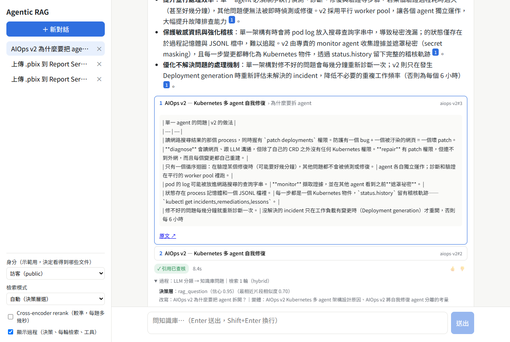
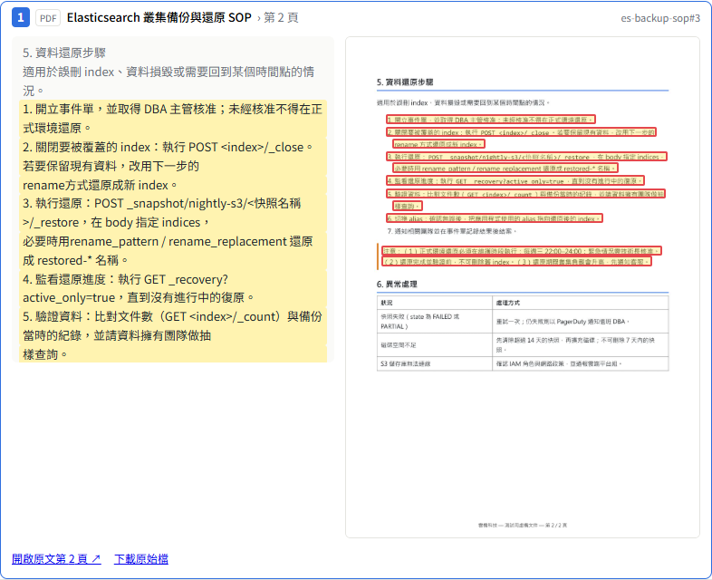

# Agentic RAG on Elasticsearch

[English](README.md) | **繁體中文**

在聊天框問一個問題，系統會去你的文件裡找出相關段落，讓語言模型只根據這些段落寫出答案，並標明用了哪幾段。文件裡查不到時，它會回答「沒有相關資料」，不會用猜的。

這種做法叫 RAG（retrieval-augmented generation，檢索增強生成）：先搜尋，再讓模型只靠搜尋到的內容回答。整個系統跑在一台機器上：Elasticsearch（搜尋引擎）放在 Docker，兩個模型透過 Ollama 跑在 8 GB 顯示卡上，`qwen3.5:4b` 負責寫答案，`bge-m3` 負責產生 embedding（用一串數字代表文字的意思，拿來找意思相近的段落）。



## 功能

可以問 Markdown、PDF、PowerPoint、Word 的內容。內建語料是我其他公開專案的繁體中文文件，加上產生出來的測試用 SOP（作業流程）和簡報。

- 搜尋有四種模式，查的是同一個索引：`keyword`（BM25，傳統的字詞比對）、`vector`（kNN，找意思最近的）、`hybrid`（兩者用加權 RRF，即 reciprocal rank fusion，合併排名）、`cascade`（先嚴格比對關鍵字，不夠再用向量補）。任何一種模式都可以再用第二個模型（reranker）把前 20 筆重新打分。
- 問題進到 agent 之前，先過一道決策步驟：先看簡單規則，再看問題跟語料有多接近，最後由 LLM 做一次有固定格式的判斷。離題的問題和 prompt injection（藏在文字裡、想給模型下新命令的攻擊）會在這裡被擋下。
- 檢索迴圈是程式在控制，不是模型決定。程式先搜尋，再問模型「這些夠不夠回答」；不夠就改寫查詢、換一個沒試過的模式再查，最多再查 2 輪。還是不夠就拒答。這種做法叫 CRAG。
- 回答的 agent 用 Pi（`@mariozechner/pi-agent-core`）做的。它只有兩個唯讀工具 `search` 和 `get_document`，透過 MCP（Model Context Protocol，讓 LLM 應用程式呼叫工具的通用協定）提供，呼叫次數有硬上限。
- 引用查核會確認答案裡引用的每個片段 id，都是這一輪真的檢索到的。編造的來源會被移除並標上警告。
- 每個被引用的 PDF 或 PowerPoint 片段，介面都會顯示那一頁的截圖（用到的幾行框起來）、引用原文，以及「開啟原文第 N 頁」的連結。
- 「要怎麼做」的問題用固定格式回答：摘要、前置條件、照原文順序的全部步驟（每步附來源）、注意事項。系統會把前後片段一起抓進來，避免跨頁的步驟漏掉。
- 權限是以文件為單位。MCP server 會在每個 Elasticsearch 查詢裡加上權限條件，模型改不了。
- 聊天介面有串流回答、編號引用、過程面板（決策、每一輪檢索、評審結果、工具呼叫）、對話紀錄、設定、讚／倒讚和文件上傳。SQLite 存使用者、設定、對話、每則訊息的完整 trace、回饋和 MCP 稽核紀錄。

## 運作方式

```
瀏覽器（React、AI SDK useChat）
   |  UI message stream（SSE）
   v
Backend（Fastify）                                    SQLite
 1 決策層    規則 -> 領域相似度 -> LLM                 users / settings / conversations
 2 CRAG 迴圈 檢索 -> 評審 -> 重查（最多 2 輪）         messages + 完整 trace / feedback
 3 Pi agent  工具：search、get_document                tool_audit
 4 引用查核  引用的 id 必須是檢索到的 id 的子集
   |  MCP（本機用 stdio；Docker 裡用 Streamable HTTP + Bearer token）
   |  使用者群組放在 request 的 _meta，不在工具參數裡
   v
MCP retrieval server（唯讀）                          Ollama（宿主機 GPU）
 search(mode, query, k, rerank) / get_document  --->  bge-m3 embedding
 每個 ES 查詢都套 ACL filter，寫稽核紀錄，             qwen3.5:4b（16k context 變體）
 選用的 cross-encoder rerank（CPU）
   |  只能讀一個 index 的 API key
   v
Elasticsearch 9.5（Basic 授權）
 content：  ICU tokenizer + 繁轉簡 filter（BM25）
 embedding：dense_vector 1024 維、cosine（kNN）
 metadata： 標題、章節路徑、來源、acl

Ingestion：Markdown -> 依標題切塊 ->「文件 > 章節」前綴 -> embedding -> upsert
           PDF / PPTX / DOCX ->（LibreOffice 轉 PDF）-> 逐頁抽出每一行與位置 + 每頁截圖 -> 切塊
```

## PDF、PowerPoint 與證據截圖



PPTX、DOCX 先用 LibreOffice（headless）轉成 PDF，所以所有格式都走同一條路。`pdfjs-dist` 逐頁一行一行讀出文字和每一行在頁面上的位置，每一頁也會渲染成 JPEG。一張投影片是一個片段，標題是「投影片 N｜投影片標題」。PDF 依長度切塊，字比內文大的短行當成章節標題。每一行的位置存在片段的 `layout` 欄位（不建索引），只有 backend 要求時，MCP server 才會回傳。

證據卡會把回答真正用到的行標出來。判斷方式是拿引用這個片段的句子，跟每一行比對字元 bigram 的重疊。截圖和原始檔都要先由 backend 問 MCP server「這個使用者看不看得到這份文件」，沒權限就拿不到。

被判成 `procedure` 的問題，系統還會把最相關片段的前後片段抓進來；步驟看起來不完整時，prompt 會要求明說。

下面是看抽出來的文字才發現的真實 PDF 問題：

| 問題 | 處理 |
|---|---|
| Chrome 列印的 PDF 會把部分漢字抽成康熙部首：「執⾏」的「⾏」是 U+2F8F 不是「行」，搜「執行」就找不到 | U+2F00–2FDF 用 NFKC 轉回；部首補充區（⻑ → 長）用對照表 |
| 自動換行把詞切斷（抽／樣），BM25 斷不出詞 | 把行接回去：中文直接接、英文補空白；全形句尾標點、條列編號、字體大小跳動時保留換行 |
| 每頁重複的頁首頁尾 | 頁面最上、最下 12% 且在多數頁面重複的行不索引 |
| 中文檔名讓片段 id 含中文，引用查核認不出來 | id 一律是 `[a-z0-9-]`；非英數檔名加短雜湊 |

結果來自 `eval/golden-files.json`：針對產生的 SOP PDF 和簡報的 13 題（其中 4 題是 SOP，另有 3 題陷阱題），加上我舊 repo 裡三份真實 PDF 的 6 題。真實 PDF 含個資，只放在本機。

| 指標 | 產生的 PDF／PPTX | 真實 PDF（僅本機） |
|---|---|---|
| 標準片段有進到 context | 100% | 83% |
| 答案正確（評審） | 92% | 83% |
| 重點涵蓋率（評審） | 85% | 72% |
| 無據內容（評審） | 8% | 17% |
| 引用查核通過 | 100% | 83% |
| SOP 回答列齊所有步驟 | 3/4 | 1/2 |
| 引用 PDF／PPT 時證據截圖可用 | 13/13 | 6/6 |
| 陷阱題（ACL 外洩、查無答案） | 2/3 | 不適用 |

人工檢查回答後發現兩個問題，都在這次評測之後才修。「要打哪支電話」被當成流程題，塞了不相關的步驟；「Kafka 要怎麼備份」借用了 Elasticsearch 的步驟，而不是說查不到。現在決策步驟把單一事實題判成 fact，SOP 的 prompt 也規定片段裡沒有那個系統的流程就要回答「沒有相關資料」。真實 PDF 沒答好的是一題表格題（資料表結構在 SQL dump 裡，切塊效果差）和一題步驟分散在報告兩個章節的 SOP。

### 圖片裡的文字

截圖、照片、掃描頁、貼上的圖表沒有文字層，原本完全搜不到。現在匯入時，有點陣圖（或幾乎沒有文字）的頁面會交給本機的看圖模型（Ollama 上的 `qwen3.5:4b`）。模型只寫出圖片裡才有的內容：圖表標題和數字、截圖裡的字、掃描的表單。跟頁面上本來就選得到的文字重複的行會被拿掉。剩下的內容變成這一頁多出來的一個片段（`kind: image`），跟其他片段一樣建 embedding 和索引。證據卡會標示這段是模型寫的描述，下面附上頁面截圖，可以自己對照原圖。描述依圖片雜湊快取，重新匯入不用重算。頁面圖片只送到本機的 Ollama。

為了測這個功能，`dc-inspection.pdf` 把重點資訊全部放在圖片裡：一張長條圖、一張 UPS 面板截圖、一張掃描的簽核表。f14～f17 四題問的就是這些內容。

| `golden-files.json` 驗收組（17 題 + 4 題陷阱） | 沒有圖片片段 | 有圖片片段 |
|---|---|---|
| 標準片段進了 context | 76% | 100% |
| 答案正確（評審） | 71% | 94% |
| 只在圖片裡的題目答對 | 0 / 4 | 3 / 4 |
| 有無據內容（評審） | 18% | 0% |

沒有圖片片段時，兩題圖片題被當成範圍外擋掉，第三題說查不到日期，第四題拿 Elasticsearch 的 SOP 來回答。有圖片片段後唯一答錯的是「巡檢發現機房有哪些設備要處理？」。決策步驟把它判成流程題，SOP 的 prompt 又因為那頁只列項目、沒有步驟而拒答。現在的 prompt 改成：片段講的是對的對象、只是沒有步驟時，就照一般方式回答。手動重問這題已經答對，但沒有整組重跑。那次回答裡，4B 模型還寫了「91% 未達 85% 警戒線」，證據卡上的截圖一看就知道錯了。規則判分把一題陷阱題（「量到的溫度是幾度？」）算成失敗，但回答其實正確說明報告裡沒有溫度。三份真實 PDF 共 97 頁，其中 64 頁產生了圖片片段。

## 評測

Golden set（[`eval/golden.json`](eval/golden.json)）有 48 題，都是依語料手寫的。分成調整組（開發時會看）和驗收組（從來不拿來調任何參數）。另外有 14 題陷阱題：範圍外、直接 prompt injection、藏在文件裡的 injection、ACL 外洩、領域內但答案不存在、閒聊。

標準答案標的是證據句子，不是片段 id：片段內容包含那句話就算相關。所以改了切塊方式，標註也不會默默失效。

### 檢索（驗收組 24 題）

Hit@k 是標準片段出現在前 k 名的題目比例。MRR@10 是「第一個標準片段的名次取倒數」的平均，越高越好，1.0 是滿分。加 `rerank=true` 時，第一段先撈 20 個候選，再用 cross-encoder（`bge-reranker-base`，ONNX、CPU）重新打分，回傳前 k 個。

| 模式 | Hit@1 | Hit@3 | Hit@5 | MRR@10 | 加 rerank：Hit@1 | Hit@5 | MRR@10 |
|---|---|---|---|---|---|---|---|
| keyword（BM25） | 67% | 75% | 83% | 0.736 | 83% | 100% | 0.906 |
| vector（kNN） | 67% | 83% | 88% | 0.764 | 83% | 92% | 0.873 |
| hybrid（加權 RRF） | 58% | 83% | 92% | 0.729 | 88% | 96% | 0.922 |
| cascade | 58% | 83% | 83% | 0.699 | 83% | 92% | 0.868 |

只有第一段時，每題 17～58 ms；rerank 約多 0.9 秒（20 個候選、CPU）。在 8 GB 的 RTX 3060 Ti 上量的。調整組上單用 keyword 弱很多（Hit@5 63%）；加了 rerank 之後，兩組的每種模式都在 MRR 0.9 左右。

這些檢索數字是 2026-10-21 重新量的，那時語料裡的 PowerBI MCP 文件已更新，並新增了三份。變差的是 q44（「每日變動分析用了哪些時間窗？」）：新的 .pbix 匯入文件也列了時間窗，排到標準片段前面。驗收組的標準答案我沒有改。下面的 rerank 模型比較和端到端結果，是在這次語料更新之前量的。

### 選 rerank 模型

`scripts/eval-rerank.ts` 在驗收組上比較不同模型和候選數（hybrid 候選）。小模型在兩組都贏，所以在調整組做的選擇到驗收組也成立。

| 設定 | MRR@10 | Hit@5 | 每題 rerank 時間 |
|---|---|---|---|
| 不 rerank | 0.773 | 92% | 無 |
| `bge-reranker-v2-m3`（568M、int8），20 個候選 | 0.861 | 96% | 3.4 s |
| `bge-reranker-base`（278M、int8），10 個候選 | 0.885 | 96% | 0.7 s |
| `bge-reranker-base`（278M、int8），20 個候選 | 0.906 | 100% | 1.6 s |

我的推測，沒驗證過：int8 量化對 v2-m3 傷得比較重。它的 fp32 版（2.2 GB）在 CPU 上太慢，這裡沒測。rerank 分數也可以當相關性訊號：門檻 0.5 時，保留 96% 的標準片段、濾掉 53～68% 的其他片段，跟 LLM 評審差不多（保留 91～93%、濾掉 65～75%）。

### 其他 rerank 後端

後端用 `RERANKER` 設定，可選：程序內的 cross-encoder（預設）、任何 `llama-server --reranking`（`/v1/rerank`）、走 System One API（`/v1/systemone`）的 decision model，或本機 LLM。llama.cpp 可以跑開源的 Julia-1、Laya、Kev 這幾個 decision model，雲端的 Jev 用同一種格式。後端失敗或逾時，就退回第一段的排序，MCP 稽核紀錄會記下來。System One 的位址不在本機時會拒絕使用，除非設 `RERANK_ALLOW_REMOTE=1`，因為那等於把文件片段送出本機。

`scripts/eval-rerankers.ts` 用每個後端重排同一批 hybrid 候選，輸出 NDCG、MRR 變化的配對 bootstrap 95% 信賴區間、依題型（單一事實、要綜合多段、換句話說）拆開的 MRR、延遲，以及最高分能不能分辨「有答案」和「沒答案」的題目。decision model 的問法在調整組上選，驗收組用選好的問法只跑一次；其他問法是事後才在驗收組上跑，只用來診斷。

| 全部 48 題，hybrid，20 個候選 | MRR@10 | 跟 bge 比（95% CI） | 調整組 MRR | 驗收組 MRR | 跑在 | 每題 p50 |
|---|---|---|---|---|---|---|
| 不 rerank | 0.707 | −0.171（−0.259 ~ −0.076） | 0.684 | 0.729 | 無 | 無 |
| `bge-reranker-base`（278M cross-encoder、ONNX） | 0.878 | 基準 | 0.833 | 0.922 | CPU | 0.8 s |
| Kev-4B（decision model、Q4、`choice` 問法） | 0.840 | −0.037（−0.142 ~ +0.063） | 0.910 | 0.771 | GPU | 1.9 s |
| 本機 LLM（`qwen3.5:4b`，一次替 20 段打分） | 0.830 | −0.048（−0.137 ~ +0.045） | 0.797 | 0.862 | GPU | 10.7 s |
| `Qwen3-Reranker-0.6B`（Q8、llama.cpp） | 0.788 | −0.090（−0.147 ~ −0.039） | 0.777 | 0.799 | CPU | 14.6 s |
| Laya（421M decision model、`doc` 問法） | 0.24 | 差很多 | 0.283 | 0.203 | CPU | 17 s |
| Julia-1（144M decision model、`choice` 問法） | 0.16 | 差很多 | 0.244 | 0.080 | CPU | 2.1 s |
| `bge-reranker-base`，50 個候選 | 0.899 | 比 20 個 +0.021 | 0.875 | 0.924 | CPU | 2.0 s |

48 題是調整組 24 題加驗收組 24 題（單一事實 30、綜合多段 8、換句話說 10）。bootstrap 是對題目重抽，所以信賴區間反映的是「只有 48 題」的不確定性。PDF／PPTX 題組的第一段已經是 MRR 0.962，沒有任何後端能再改善（bge 0.923、Kev 0.962）。延遲只能互相比較：有幾輪跑的時候，電腦上還有其他程式。

從這些結果我得到的結論：

- 預設維持 `bge-reranker-base`、20 個候選。沒有任何後端顯著比它好，而且只有它同時是最準的，又跑在 CPU 上，不跟答案模型搶 GPU。50 個候選只多 0.02 MRR，在重跑一次就會差 0.04 的雜訊範圍內，時間卻是 2.4 倍。
- Kev-4B 跟 bge 打平。它在調整組領先（0.910 對 0.833，但信賴區間含 0），到了驗收組三種問法都輸（0.77～0.84 對 0.92）。只用 24 題挑問法，會過擬合。
- 小的開源 decision model 不能直接當 reranker 用。Julia-1 和 Laya 把標準片段排得比亂排還後面。Laya 對幾乎每段 300～600 字的真實片段，「這段能回答問題嗎？」都給 0.6～0.9；Julia-1 換個問法，排名就整個反過來。它們是設計來在幾個短選項中挑一個的，也許比較適合當決策步驟的分類器，這個我還沒試。
- 在這份語料上，Qwen3-Reranker 顯著比小的 bge 模型差，在 CPU 上還慢 17 倍。它對很多候選都給接近 1.0 的分數。
- llama.cpp 的 decision model server 還很新。Kev 的 server 大約處理一千個請求後就不再回應，GPU 卻一直維持 100%。評測會重開 server，從分數快取接著跑。真的要用之前請先再確認。
- rerank 分數分得出「有答案」和「沒答案」的題目（最高分的 AUROC 0.98～1.00，第一段是 0.80）。但只有 6 題沒答案的題目，這只是之後設門檻的線索，還不是證據。

### 微調 embedding 模型（沒有幫助）

檢索漏掉的題目，大多是用詞對不上：問題說「電費」，文件寫「度電」。常見的解法是用自己的文件微調 embedding 模型，所以我用 `scripts/finetune/` 裡的腳本試了一次。

- 訓練資料：用 Claude Code CLI（Sonnet）替 287 個公開片段各寫三個口語問題。它沒看過評測題；產生的問題裡有 19 題跟評測題太像（cosine ≥ 0.85），已經丟掉。`corpus-local/` 的真實 PDF 沒有送出去。最後得到 783 組訓練配對、59 組驗證配對。
- 訓練方式：只訓練 bge-m3 attention 和 dense 層上的 LoRA（5.68 億參數裡的 710 萬），loss 是 InfoNCE，同一批的其他片段當負例（`CachedMultipleNegativesRankingLoss`），困難負例可選。全參數微調在 8GB GPU 上放不下。訓練完轉成 GGUF 放進 Ollama。沒訓練過的模型照同樣流程轉出來，向量跟 Ollama 官方的 bge-m3 完全一樣（cosine 1.00000），所以轉檔本身不會造成差異。

結果反而變差：

| 向量檢索 MRR@10 | 驗證集（產生的問題） | 調整組（我寫的題目） |
|---|---|---|
| bge-m3，沒有微調 | 0.538 | **0.743** |
| lr 1e-4、2 個 epoch、困難負例 | 0.583 | 0.584 |
| lr 5e-5、1 個 epoch | 0.566 | 0.653 |
| lr 2e-5、1 個 epoch、困難負例 | 0.543 | 0.685 |
| lr 2e-5、1 個 epoch | 0.539 | 0.706 |

模型在產生的問題上越進步，在我寫的題目上就越退步。它學到的是 Claude 的出題方式，不是一般人怎麼問。第一個模型也在驗收組上跑過，同樣變差：向量 MRR 從 0.764 掉到 0.669，hybrid 從 0.729 掉到 0.715，不過兩者的信賴區間都含 0。它讓換句話說的題目進步（0.44 → 0.63），但要綜合多段的題目退步（0.54 → 0.23）。每組設定在調整組上都輸，所以預設維持原本的 bge-m3，驗收組也沒有再跑。要讓微調有用，需要真實使用者的問題（從紀錄或回饋來），而不是產生的問題；挑設定也需要比 24 題更多的調整組題目。

<sub>表格第一列是把 427 個片段分別用兩個模型重建索引後，在 Elasticsearch 上量的。其他列是在 Python 裡用同一批匯出的片段算的（`scripts/finetune/export-eval.ts`），這種算法對沒微調的 bge-m3 算出來也是 0.743，跟 Elasticsearch 一致。</sub>

### 端到端（驗收組）

答案由 `rag-qwen3.5-4b` 生成，用比生成模型大的 `qwen3.5:9b` 當評審，再人工抽查。陷阱題用規則判分（禁止字串、是否拒答），不用 LLM。

| 指標（驗收組：24 題 + 7 題陷阱） | 決策層（預設） | 沒有決策層 | + rerank v2-m3（舊） | + rerank base（在 MCP 裡） |
|---|---|---|---|---|
| 正常問題被誤擋 | 0% | 不適用 | 0% | 0% |
| 標準片段有進到 context | 88% | 92% | 92% | 92% |
| 答案正確（評審） | 83% | 79% | 79% | 88% |
| 重點涵蓋率（評審） | 81% | 79% | 83% | 88% |
| 有無據內容（評審，越低越好） | 13% | 21% | 21% | 13% |
| 引用查核通過（程式） | 79% | 83% | 96% | 88% |
| 陷阱題通過（規則判分） | 6/7 | 6/7 | 5/7 | 6/7 |
| 陷阱題通過（人工複核後） | 6/7 | 7/7 | 6/7 | 7/7 |
| 平均耗時（陷阱題） | 7.0 s（4.7 s） | 4.9 s（7.5 s） | 8.8 s（6.8 s） | 無法比較* |

原始回答、trace 和評審評語在 `results/e2e-test-*.json`。這個資料夾被 git 忽略，要的話用「執行方式」裡的指令重跑。規則判分會漏認換句話說的正確拒答（「知識庫中無法執行您的請求」「沒有資料顯示…」），人工複核算通過。「嗨，你好！」在前兩輪有決策層的評測都被當成範圍外擋下，後來加了招呼語規則，最後一輪就修好了。

\* 最後一輪評測時，同一張 GPU 上有遊戲在跑，連 rerank 碰不到的階段都變慢了（決策 2.3 → 6.7 秒、生成 2.3 → 5.2 秒），所以那輪平均 19 秒跟 rerank 無關。品質指標不受影響（temperature 0）。

### 數據帶來的改變

驗收組只有 24 題，一題大約就是 4 個百分點，所以差距只能看方向，不能當成結論。

- 第一個 rerank 模型只改善了檢索，第二個連答案都變好。用 `bge-reranker-v2-m3` 時答案正確率停在 79%。換成較小的 `bge-reranker-base`、把 rerank 搬進 MCP server、只查改寫後的問題之後，答案正確率和重點涵蓋率都到 88%。rerank 仍是選用，因為在 CPU 上每輪檢索要多約 1 秒。
- 決策步驟主要是安全和成本的功能。範圍外和 injection 的陷阱題在進 agent 之前就擋下（4.7 秒對 7.5 秒），回答裡的無據內容也比較少（13% 對 21%）。代價是每題多 2 秒左右，而且它改寫查詢後，標準片段進到 context 的比例略低（88% 對 92%）。
- 不加 rerank 時，各模式的差距在雜訊範圍內。同樣的第一段程式在驗收組跑兩次，MRR 最多差 0.04（hybrid 0.733 → 0.775、keyword 0.750 → 0.732）。可能的原因是重新灌資料後索引 segment 合併，改變了 BM25 的統計值，再加上 embedding 的微小差異。這跟 keyword、vector、hybrid 之間的差距一樣大，所以調整組定的 BM25 權重 0.3 好不好，目前證明不了。加了 rerank 之後各模式都收斂到 MRR 0.91 左右。
- CRAG 評審會把對的片段丟掉。q34 第一輪就檢索到標準片段，評審判成不相關，結果回答「查不到」。可能的下一步：永遠保留前幾名，或用更大的模型當評審。
- 最大的改進來自看 trace，不是調參數：繁體中文斷詞（用 ICU 取代 smartcn）、決策步驟在看到最相近片段之前會誤擋正常問題、模型只要看到專案名稱就選 `keyword` 模式。

## 設計取捨

| 決定 | 原因 |
|---|---|
| ICU tokenizer + 繁轉簡 filter，不用 `smartcn` | `standard` 會把中文逐字切。`smartcn` 只認得簡體；我實測過，繁體一樣逐字切。ICU 繁簡都能斷詞，再加繁轉簡 filter，「资料」和「資料」就是同一個 token。 |
| 在 TypeScript 算 RRF，不用 ES 的 `rrf` retriever | `rrf` retriever 要 Platinum 授權，Basic 會回 403（實測）。自己算還能看清楚、調得動：調整組上 BM25 權重 0.3 比 1.0 好。 |
| Pi SDK 內嵌，不用 ACP 或 Goose | ACP 是操控外部的 coding agent，它自帶讀寫檔和終端機；Goose 內建 shell。問答 agent 最安全的做法，是讓它根本沒有危險的能力：兩個唯讀工具，沒有別的。 |
| CRAG 迴圈由程式控制 | 4B 模型自己決定流程不穩。模型只做窄範圍的 JSON 任務（分類、改寫、評審），下一步由程式決定，同樣的查詢加模式不會重查。 |
| 決策步驟看得到最相近的片段 | 沒有這個提示時，模型把「整天開著電腦跑 japan-trip-bot 電費多少」當成一般知識拒答（信心 0.95）。相似度夠高時，以檢索結果推翻「範圍外」的判斷（「injection」不推翻）。 |
| 門檻用調整組定 | 正常問題跟語料的 cosine 相似度最低 0.61，範圍外最高 0.50，所以門檻設 0.55。 |
| embedding 前加上章節路徑 | Contextual Retrieval 的便宜版本：每塊前面接「文件 > 章節 > 小節」，不用另外呼叫 LLM。 |
| SQLite，不用 Redis | 一台機器、一個 app。Redis 要等到多個 app 實例共用 session 才划算。 |
| rerank 放在 MCP server、用小模型 | 任何 MCP client 都能在任一模式加 `rerank=true`。`bge-reranker-base` 在兩組都比 `bge-reranker-v2-m3`（int8）準，時間只要三分之一。開 rerank 時只查改寫後的問題：20 個候選的 Hit@5 已經是 100%，每個查詢變體都 rerank 只會讓 CPU 時間成倍增加。 |

## 安全模型

每一層都假設上一層已經被突破。

| 層 | 做法 | 擋什麼 |
|---|---|---|
| 能力 | agent 只有 `search`、`get_document`，都標 `readOnlyHint` | 寫檔、執行指令、上網 |
| 資料 | MCP server 用只能讀單一 index 的 API key（寫入、刪除、讀其他 index 都回 403，實測） | MCP server 被騙去做的任何事 |
| 存取控制 | 每塊都有 `acl`；MCP server 依 `_meta.groups` 加 filter，LLM 看不到也改不了。沒權限和不存在，回的結果一樣 | 看到別的團隊的文件 |
| 輸入 | 決策步驟：規則、領域相似度、固定格式的判斷 | 拿來做別的事、直接 injection |
| 內容 | 檢索內容包成資料區塊，prompt 明說不是指令；用[陷阱文件](corpus/zz-injection-test.md)測試 | 間接 prompt injection |
| 輸出 | 引用查核 | 編造來源 |
| 程序 | Docker：唯讀檔案系統、非 root、`cap_drop: ALL`、`no-new-privileges`；HTTP 模式的 MCP 要 Bearer token；rerank 模型在 build 時就放進 image，MCP 容器執行時不需要外網 | 爆炸半徑 |
| 稽核 | 每次 MCP 呼叫（誰、查什麼、回了哪些片段）都存進 SQLite | 事後追查 |
| 上傳 | 只有 admin；acl 只能選自己有的群組；上傳檔案裡的 frontmatter `acl` 不採信 | 透過上傳提權 |

## 執行方式

需要 Node.js 22 以上、Docker、有顯示卡的 [Ollama](https://ollama.com)（8 GB 就夠）；處理 PowerPoint 和 Word 需要 LibreOffice（`soffice` 在 PATH 上，Windows 可以裝在 WSL 裡；Docker image 已內建）。

```bash
git clone https://github.com/KJLavender/agentic-rag-es.git
cd agentic-rag-es
npm install
cp .env.example .env              # 設定 ELASTIC_PASSWORD 和 MCP_TOKEN

ollama pull qwen3.5:4b && ollama pull bge-m3
npm run setup:model               # 建 16k context 的變體（Ollama 的 OpenAI 介面會忽略 num_ctx）

docker compose up -d              # 裝好 ICU plugin 的 Elasticsearch
npm run es:setup                  # 建索引、發兩把最小權限的 API key -> .env.local
npm run ingest                    # corpus/ + corpus/files/（PDF、PPTX）-> 切塊 -> embedding -> Elasticsearch

npm run build:web && npm start    # http://127.0.0.1:8787
```

其他入口：

```bash
npm run ask -- "AIOps v2 為什麼要把 agent 拆開？"            # 在終端機跑整條流程
npm run ask -- --groups team --rerank "Report Server 上傳 422 怎麼辦？"
npm run mcp                                                  # stdio 的 MCP server（可以接 MCP Inspector）
npm run eval:retrieval -- --split test --rerank
npx tsx scripts/eval-rerank.ts --split test                 # rerank 模型 x 候選數
npx tsx scripts/eval-rerankers.ts --split test --rerankers none,bge,qwen3,laya:doc   # rerank 後端（要先開 llama-server）
npm run eval:e2e -- --split test [--no-decision] [--rerank] [--mode hybrid]
npm test                                                     # 29 個測試
```

要全部放進 Docker（Ollama 留在宿主機）：

```bash
docker compose --env-file .env --env-file .env.local --profile app up -d --build
```

介面左下角可以切換身分：`guest` 只看得到 public 文件，`member` 多了 team，`admin` 還能上傳文件。這是用來示範權限控制，不是登入機制（見「限制」）。

## 設定

寫在 `.env`（或環境變數）。其他變數如 `ES_INDEX`、`PORT`、`LLM_NUM_CTX`，請看 `src/config.ts`。

| 變數 | 預設值 | 說明 |
|---|---|---|
| `ES_URL` | `http://127.0.0.1:9200` | Elasticsearch |
| `ES_INGEST_API_KEY` / `ES_SEARCH_API_KEY` | 由 `npm run es:setup` 產生 | 寫入用（ingestion、上傳）／唯讀（MCP server） |
| `OLLAMA_URL` | `http://127.0.0.1:11434` | Ollama |
| `LLM_BASE_MODEL` / `LLM_MODEL` | `qwen3.5:4b` / `rag-qwen3.5-4b` | 原始模型／全部共用的 16k context 變體 |
| `EMBED_MODEL` / `EMBED_DIMS` | `bge-m3` / `1024` | 要跟索引 mapping 一致；更換要執行 `npm run es:setup -- --recreate` |
| `CHUNK_MAX_CHARS` / `CHUNK_OVERLAP` | `600` / `80` | 切塊大小、重疊（字數） |
| `HYBRID_KEYWORD_WEIGHT` | `0.3` | hybrid RRF 裡 BM25 的權重（向量算 1） |
| `RERANK_MODEL` / `RERANK_CANDIDATES` | `Xenova/bge-reranker-base` / `20` | cross-encoder 模型、第一段撈幾個候選給它重排 |
| `RERANKER` / `RERANK_URL` / `RERANK_FORMAT` | `cross-encoder` / 未設定 / `pair` | rerank 後端：`cross-encoder`、`rerank-api`、`systemone` 或 `llm`；後端的位址；System One 的問法 |
| `RERANK_TIMEOUT_MS` / `RERANK_ALLOW_REMOTE` | `15000` / 未設定 | 超過就用第一段的排序；允許不在本機的後端 |
| `DOMAIN_MIN_SIMILARITY` / `DOMAIN_STRONG_SIMILARITY` | `0.55` / `0.65` | 低於前者：範圍外；高於後者：推翻 LLM 的「範圍外」 |
| `DECISION_MIN_CONFIDENCE` | `0.5` | 低於就請使用者講清楚 |
| `MAX_RETRIEVAL_ROUNDS` | `2` | CRAG 最多再查幾輪 |
| `CONTEXT_K` | `6` | 每輪取幾個片段 |
| `VISION_MODEL` / `VISION_PAGES` | `qwen3.5:4b` / `auto` | 描述頁面圖片的 Ollama 看圖模型；哪些頁面要看：`auto`（有圖片或幾乎沒文字的頁面）、`all`、`off` |
| `DOCS_DIR` | `data/docs` | 原始檔、轉出的 PDF、每頁截圖 |
| `MCP_URL` / `MCP_TOKEN` | 未設定 | 改用 Streamable HTTP，而不是 stdio 子程序 |

## 專案結構

```
src/
  ingest/        切塊（依標題、濾掉垃圾片段、章節前綴）、PDF 頁面、圖片描述、upsert
  retrieval/     四種模式、RRF、選用的 rerank（cross-encoder／llama.cpp／System One／LLM）
  mcp/           MCP retrieval server（stdio / Streamable HTTP）
  agent/         決策層、評審、CRAG 流程、Pi 生成、引用查核
  db/            SQLite schema
  server/        Fastify API + AI SDK UI message stream
  shared/        跟前端共用的訊息型別
web/             React 介面
scripts/         es:setup、ingest、ask、評測、門檻校準、網頁冒煙測試
  finetune/      用 Claude CLI 產生訓練配對、LoRA 微調 bge-m3、轉 GGUF 放進 Ollama、比較
eval/            golden.json（題目、證據句子、陷阱題）、golden-files.json
corpus/          內建文件（含一份 prompt injection 陷阱）
```

## 限制

- 沒有真正的登入。切換身分只是個 cookie，用來示範權限控制。要給別人用之前，請放在 SSO 或反向代理後面。
- 4B 模型偶爾會混進簡體字（用 OpenCC 轉回繁體）、過度解讀片段或漏掉重點。過程面板和引用查核讓問題看得見，但擋不住。
- 評測規模小。單一語料、驗收組 24 題是方法示範，不是 benchmark。LLM 評審本身也是模型，它的評語都留在 `results/` 供複核。
- 一張 GPU，一次一題，其他請求會排隊。
- 圖片裡的字是 4B 的看圖模型讀的，不是專門的 OCR 引擎，小字或數字可能讀錯；所以圖片片段都會標示，並附上頁面截圖。圖片多的 PDF 第一次匯入會比較慢（每頁幾秒）。
- PDF 表格是一列一列抽出來的，跨行的儲存格會交錯，問表格內容沒有問一般段落準。
- Elasticsearch 在 localhost 上走 HTTP。對外開放前要開 TLS。
- Rerank 在 CPU 上跑，每輪檢索多約 1 秒。本機第一次使用會下載模型（約 280 MB）；Docker image 已經內建。

## 授權

MIT
