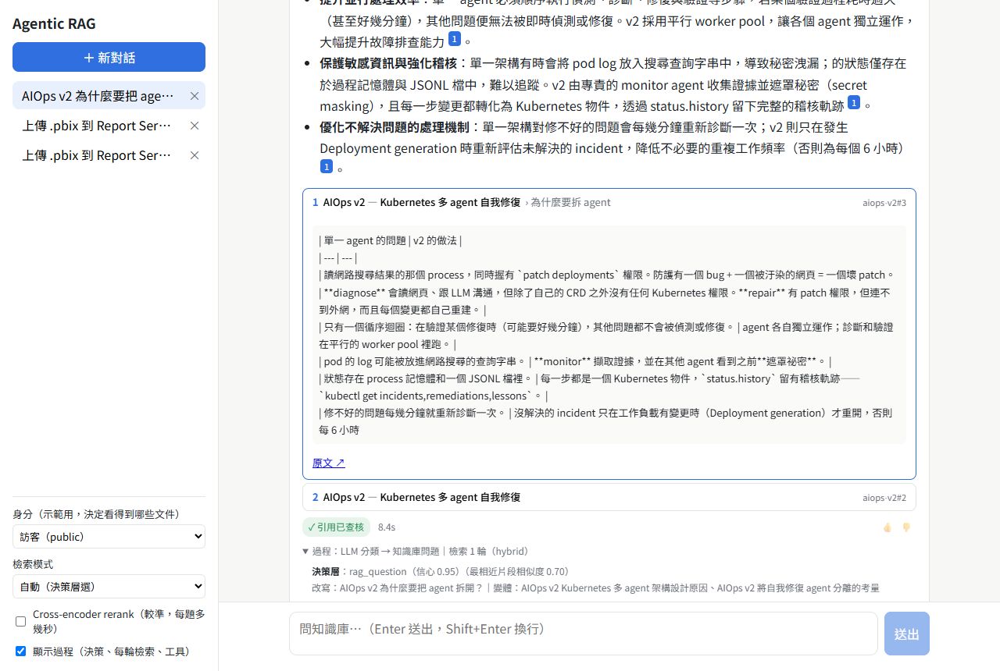

<div align="center">

# Agentic RAG on Elasticsearch

[English](README.md) | **繁體中文**

**從頭到尾自己做一遍的全端 RAG：文件切塊與 ingestion、包在唯讀 MCP server 後面的四種檢索模式、
決策層、CRAG 式的檢索迴圈、會附來源的 Pi agent，以及保留驗收組的評測。**

全部在本機執行：Elasticsearch 跑在 Docker，`qwen3.5:4b` 和 `bge-m3` 透過 Ollama 跑在 8 GB 顯示卡上。




</div>

---

## 目錄

- [功能](#功能)
- [架構](#架構)
- [評測](#評測)
- [設計取捨](#設計取捨)
- [安全模型](#安全模型)
- [快速開始](#快速開始)
- [設定](#設定)
- [專案結構](#專案結構)
- [限制](#限制)

## 功能

對一批文件提問（內建語料是我其他公開專案的繁體中文文件）。每個回答都根據檢索到的片段、附上來源；
查不到就說「沒有相關資料」，不會用猜的。

- **四種檢索模式**，查同一個索引：`keyword`（BM25）、`vector`（kNN）、
  `hybrid`（在 TypeScript 裡算加權 RRF）、`cascade`（先嚴格關鍵字，不夠再用向量補）。
- **決策層**擋在 agent 前面：規則 → 領域相似度 → LLM typed decision。範圍外的問題和 prompt injection 根本進不了 agent。
- **CRAG 迴圈由程式控制，不交給模型**：檢索 → 評審「夠不夠回答」→ 換查詢、換沒試過的模式再查 → 生成，或 fail-closed。
- **Pi agent**（`@mariozechner/pi-agent-core`）只有兩個透過 MCP 的唯讀工具，呼叫次數有硬上限。
- **引用查核**：回答裡引用的每個片段 id，都必須是這一輪真的檢索到的；編造的來源會被移除並標 ⚠。
- **文件級權限（ACL）**在 MCP server 的 Elasticsearch 查詢裡強制套用，不靠 LLM 判斷。
- **聊天介面**：串流回答、編號引用、來源卡、過程面板（決策、每一輪檢索、評審結果、工具呼叫）、
  對話紀錄、設定、👍/👎、文件上傳。
- **SQLite** 存使用者、設定、對話、每則訊息的完整 trace、回饋和 MCP 稽核紀錄。

## 架構

```
瀏覽器（React、AI SDK useChat）
   │  UI message stream（SSE）
   ▼
Backend（Fastify）                                    SQLite
 ① 決策層    規則 → 領域相似度 → LLM 分類       ── users / settings / conversations
 ② CRAG 迴圈 檢索 → 評審 → 重查（最多 2 輪）       messages + 完整 trace / feedback
 ③ Pi agent  工具：search、get_document              tool_audit
 ④ 引用查核  引用的 id ⊂ 檢索到的 id
   │  MCP（本機用 stdio；Docker 裡用 Streamable HTTP + Bearer token）
   │  使用者群組放在 request 的 _meta，不在工具參數裡
   ▼
MCP retrieval server（唯讀）                         Ollama（宿主機 GPU）
 search(mode, query, k) / get_document(id)    ─────▶ bge-m3 embedding
 每個 ES 查詢都套 ACL filter，寫稽核紀錄               qwen3.5:4b（16k context 變體）
   │  只能讀一個 index 的 API key
   ▼
Elasticsearch 9.5（Basic 授權）
 content：ICU tokenizer + 繁轉簡 filter（BM25）
 embedding：dense_vector 1024 維、cosine（kNN）
 metadata：標題、章節路徑、來源、acl
   ▲
Ingestion：Markdown → 依標題切塊 →「文件 > 章節」前綴 → embedding → upsert
```

## 評測

Golden set（[`eval/golden.json`](eval/golden.json)）有 **48 題**，都是依語料手寫的，分成
**調整組**（開發時看）和**驗收組**（從來不拿來調任何參數），另外有 **14 題陷阱題**：範圍外、
直接 prompt injection、藏在文件裡的 injection、ACL 外洩、領域內但答案不存在、閒聊。

標準答案標的是**證據句子**，不是片段 id：片段內容包含那句話就算相關。所以改了切塊策略，標註也不會默默失效。

### 檢索（驗收組 24 題）

| 模式 | Hit@1 | Hit@3 | Hit@5 | MRR@10 | 平均延遲 |
|---|---|---|---|---|---|
| keyword（BM25） | 67% | 79% | 88% | 0.750 | 34 ms |
| vector（kNN） | 67% | 83% | 88% | 0.764 | 233 ms* |
| hybrid（加權 RRF） | 58% | 83% | **92%** | 0.733 | 36 ms |
| cascade | 58% | 83% | 83% | 0.699 | 36 ms |
| **hybrid + rerank** | **79%** | **96%** | **96%** | **0.861** | 2.8 s |

<sub>* 包含第一題暖機 embedding 模型的時間。RTX 3060 Ti 8GB，rerank 在 CPU 上跑。
調整組的排名不一樣：keyword Hit@5 63%、vector 92%、hybrid 92%、hybrid + rerank 96%（MRR 0.819）。</sub>

### 端到端（驗收組）

由 `rag-qwen3.5-4b` 生成，用比生成模型大的 `qwen3.5:9b` 當評審，再人工抽查。
陷阱題用規則判分（禁止字串、是否拒答），不用 LLM。

| 指標（驗收組：24 題 + 7 題陷阱） | 決策層（預設） | 沒有決策層 | 決策層 + rerank |
|---|---|---|---|
| 正常問題被誤擋 | 0% | — | 0% |
| 標準片段有進到 context | 88% | 92% | 92% |
| 答案正確（評審） | **83%** | 79% | 79% |
| 重點涵蓋率（評審） | 81% | 79% | 83% |
| 有無據內容（評審，越低越好） | **13%** | 21% | 21% |
| 引用查核通過（程式） | 79% | 83% | **96%** |
| 陷阱題通過（規則判分） | 6/7 | 6/7 | 5/7 |
| 陷阱題通過（人工複核後） | 6/7 | 7/7 | 6/7 |
| 平均耗時（陷阱題） | 7.0 s（4.7 s） | 4.9 s（7.5 s） | 8.8 s（6.8 s） |

<sub>原始回答、trace 和評審評語都在 `results/e2e-test-*.json`（不進 git，可以用「快速開始」的指令重跑）。
規則判分漏認了兩個換句話說的正確拒答（「知識庫中無法執行您的請求」「沒有資料顯示…」），人工複核算通過。
有決策層的兩組都沒過的陷阱題是「嗨，你好！」：被領域相似度當成範圍外擋下。
招呼語規則是**跑完這次驗收之後**才加的，所以上面的數字是修正前的。</sub>

### 數據帶來的改變

驗收組只有 24 題，一題大約就是 4 個百分點，所以差距只能看方向，不能當成結論。

- **Rerank 贏在檢索，不在答案。** 兩組都是最好的檢索方式（驗收組 MRR 0.86），引用查核也拉到 96%，但最終答案正確率沒有提高。在這個規模下瓶頸是 4B 的生成模型，所以 rerank 維持選用。
- **決策層主要是安全和成本的功能。** 範圍外和 injection 的陷阱題在進 agent 之前就擋下（4.7 秒對 7.5 秒），回答裡的無據內容也比較少（13% 對 21%）。代價是每題多 2 秒左右，而且它改寫查詢後，標準片段進到 context 的比例略低（88% 對 92%）。
- **用 24 題調出來的參數沒有推廣到驗收組。** hybrid 的 BM25 權重 0.3 是在調整組定的，那組 keyword 很弱（Hit@5 63%）。到了驗收組，keyword 跟向量一樣好，單純 hybrid 的 MRR 反而比兩者都低。
- **CRAG 評審會把對的片段丟掉。** q34 第一輪就檢索到標準片段，評審判成不相關，結果回答「查不到」。下一步：永遠保留前幾名，或用更大的模型當評審。
- **最大的改進來自看 trace，不是調參數：** 繁體中文斷詞（用 ICU 取代 smartcn）、決策層在看到最相近片段之前會誤擋正常問題、模型只要看到專案名稱就選 `keyword` 模式。

## 設計取捨

| 決定 | 原因 |
|---|---|
| **ICU tokenizer + 繁轉簡 filter**，不用 `smartcn` | `standard` 會把中文逐字切。`smartcn` 只認得簡體——實測繁體一樣逐字切。ICU 繁簡都能斷詞，再加繁轉簡 filter，「资料」和「資料」就是同一個 token。 |
| **在 TypeScript 算 RRF**，不用 ES 的 `rrf` retriever | `rrf` retriever 要 Platinum 授權，Basic 會回 403（實測）。自己算還能看清楚、調得動：調整組上 BM25 權重 0.3 比 1.0 好。 |
| **Pi SDK 內嵌**，不用 ACP 或 Goose | ACP 是操控外部 coding agent，它自帶讀寫檔和終端機；Goose 內建 shell。問答 agent 最安全的做法是根本沒有危險能力：兩個唯讀工具，沒有別的。 |
| **CRAG 迴圈由程式控制** | 4B 模型自己決定流程不穩。模型只做窄的 JSON 任務（分類、改寫、評審），下一步由程式決定，同樣的查詢＋模式不會重查。 |
| **決策層看得到最相近的片段** | 沒有這個提示時，模型把「整天開著電腦跑 japan-trip-bot 電費多少」當成一般知識拒答（信心 0.95）。相似度夠高時，以檢索結果推翻「範圍外」的判斷（「injection」不推翻）。 |
| **門檻用調整組定** | 正常問題跟語料的 cosine 相似度最低 0.61，範圍外最高 0.50，所以門檻設 0.55。 |
| **embedding 前加上章節路徑** | Contextual Retrieval 的便宜版本：每塊前面接「文件 > 章節 > 小節」，不用另外呼叫 LLM。 |
| **SQLite，不用 Redis** | 一台機器、一個 app。Redis 要等到多台 app 共用 session 才划算。 |
| **Cross-encoder rerank 做成選項** | `bge-reranker-v2-m3`（ONNX、CPU）排序明顯變好，但每題多好幾秒，所以讓使用者自己開。 |

## 安全模型

每一層都假設上一層已經被突破。

| 層 | 做法 | 擋什麼 |
|---|---|---|
| 能力 | agent 只有 `search`、`get_document`，都標 `readOnlyHint` | 寫檔、執行指令、上網 |
| 資料 | MCP server 用只能讀單一 index 的 API key（寫入、刪除、讀其他 index 都回 403，實測） | MCP server 被騙去做的任何事 |
| 存取控制 | 每塊都有 `acl`；MCP server 依 `_meta.groups` 加 filter，LLM 看不到也改不了。沒權限和不存在回的結果一樣 | 看到別的團隊的文件 |
| 輸入 | 決策層：規則、領域相似度、typed decision | 拿來做別的事、直接 injection |
| 內容 | 檢索內容包成資料區塊，prompt 明說不是指令；用[陷阱文件](corpus/zz-injection-test.md)測試 | 間接 prompt injection |
| 輸出 | 引用查核 | 編造來源 |
| 程序 | Docker：唯讀檔案系統、非 root、`cap_drop: ALL`、`no-new-privileges`；HTTP 模式的 MCP 要 Bearer token | 爆炸半徑 |
| 稽核 | 每次 MCP 呼叫（誰、查什麼、回了哪些片段）都存進 SQLite | 事後追查 |
| 上傳 | 只有 admin；acl 只能選自己有的群組；上傳檔案裡的 frontmatter `acl` 不採信 | 透過上傳提權 |

## 快速開始

需要：Node.js 22 以上、Docker、[Ollama](https://ollama.com) 和顯示卡（8 GB 就夠）。

```bash
git clone https://github.com/KJLavender/agentic-rag-es.git
cd agentic-rag-es
npm install
cp .env.example .env              # 設定 ELASTIC_PASSWORD 和 MCP_TOKEN

ollama pull qwen3.5:4b && ollama pull bge-m3
npm run setup:model               # 建 16k context 的變體（Ollama 的 OpenAI 介面會忽略 num_ctx）

docker compose up -d              # 裝好 ICU plugin 的 Elasticsearch
npm run es:setup                  # 建索引、發兩把最小權限的 API key → .env.local
npm run ingest                    # corpus/ → 切塊 → embedding → Elasticsearch

npm run build:web && npm start    # http://127.0.0.1:8787
```

其他入口：

```bash
npm run ask -- "AIOps v2 為什麼要把 agent 拆開？"            # 在終端機跑整條流程
npm run ask -- --groups team --rerank "Report Server 上傳 422 怎麼辦？"
npm run mcp                                                  # stdio 的 MCP server（可以接 MCP Inspector）
npm run eval:retrieval -- --split test --rerank
npm run eval:e2e -- --split test [--no-decision] [--rerank] [--mode hybrid]
npm test
```

全部放進 Docker（Ollama 留在宿主機）：

```bash
docker compose --env-file .env --env-file .env.local --profile app up -d --build
```

介面左下角可以切換身分（`guest` 只看 public、`member` 多了 team、`admin` 還能上傳文件），
用來示範 ACL。這**不是**登入機制，見[限制](#限制)。

## 設定

| 變數 | 預設值 | 說明 |
|---|---|---|
| `ES_URL` | `http://127.0.0.1:9200` | Elasticsearch |
| `ES_INGEST_API_KEY` / `ES_SEARCH_API_KEY` | 由 `npm run es:setup` 產生 | 寫入用（ingestion、上傳）／唯讀（MCP server） |
| `OLLAMA_URL` | `http://127.0.0.1:11434` | Ollama |
| `LLM_BASE_MODEL` / `LLM_MODEL` | `qwen3.5:4b` / `rag-qwen3.5-4b` | 原始模型／全部共用的 16k context 變體 |
| `EMBED_MODEL` / `EMBED_DIMS` | `bge-m3` / `1024` | 要跟索引 mapping 一致；換模型要 `es:setup -- --recreate` |
| `CHUNK_MAX_CHARS` / `CHUNK_OVERLAP` | `600` / `80` | 切塊大小、重疊 |
| `HYBRID_KEYWORD_WEIGHT` | `0.3` | hybrid RRF 裡 BM25 的權重（向量是 1） |
| `DOMAIN_MIN_SIMILARITY` / `DOMAIN_STRONG_SIMILARITY` | `0.55` / `0.65` | 低於：範圍外；高於：推翻 LLM 的「範圍外」 |
| `DECISION_MIN_CONFIDENCE` | `0.5` | 低於就請使用者講清楚 |
| `MAX_RETRIEVAL_ROUNDS` | `2` | CRAG 最多再查幾輪 |
| `CONTEXT_K` | `6` | 每輪取幾個片段 |
| `MCP_URL` / `MCP_TOKEN` | 未設定 | 改用 Streamable HTTP，而不是 stdio 子程序 |

## 專案結構

```
src/
  ingest/        切塊（依標題、濾掉垃圾片段、章節前綴）與 upsert
  retrieval/     四種模式、RRF、選用的 cross-encoder rerank
  mcp/           MCP retrieval server（stdio / Streamable HTTP）
  agent/         決策層、評審、CRAG 流程、Pi 生成、引用查核
  db/            SQLite schema
  server/        Fastify API + AI SDK UI message stream
  shared/        跟前端共用的訊息型別
web/             React 介面
scripts/         es:setup、ingest、ask、評測、門檻校準、網頁冒煙測試
eval/golden.json 題目、證據句子、陷阱題
corpus/          內建文件（含一份 prompt injection 陷阱）
docs/plan.md     原始計畫
```

## 限制

- **沒有真正的登入。** 切換身分只是個 cookie，用來示範 ACL。要給別人用之前請放在 SSO 或反向代理後面。
- **4B 模型。** 偶爾會混進簡體字（用 OpenCC 轉回繁體）、過度解讀片段或漏掉重點；過程面板和引用查核讓問題看得見，但擋不住。
- **評測規模小。** 單一語料、驗收組 24 題是方法示範，不是 benchmark。LLM 評審本身也是模型，它的評語都留在 `results/` 供複核。
- **一張 GPU，一次一題。** 其他請求會排隊。
- **Elasticsearch 走 HTTP**，只開在 localhost。對外開放前要開 TLS。
- **Rerank 在 CPU 上跑**，每題多好幾秒。

## 授權

MIT
